# The Platonic Translation Workshop

An interactive exegesis of Plato, for personal use: the Greek text, every word's
dictionary and grammar evidence, the historical translations, and the
commentary tradition, all keyed to Stephanus references so that wherever you
read, everything said about that passage is at hand. No AI: every lookup comes
from a dictionary, a morphological table or a dated edition.

This folder is separate from the music code in the rest of the repository and
shares nothing with it.

## Status

**Milestone 1, sources and setup: done.** The sources are chosen, pinned,
downloaded and checked. See:

- [`sources/manifest.json`](sources/manifest.json): every source, with its repository, pinned commit, licence and provenance.
- [`reports/verification.md`](reports/verification.md): what the checks found, with every figure computed from the files.
- [`sources/COMMENTARIES.md`](sources/COMMENTARIES.md): the commentary survey (clean text, OCR, scan only, or not yet checked).
- [`sources/TIMAEUS_PILOT.md`](sources/TIMAEUS_PILOT.md): the commentaries the pipeline will be proven on.
- [`sources/taylor-1804/`](sources/taylor-1804/): the OCR text of Taylor and Sydenham's 1804 Works of Plato.

**Milestone 2, the Timaeus reader and its database: done.** The Greek
Timaeus with Stephanus navigation, Bury's English beside it, his footnotes as
the first commentary, the references in those footnotes as links, and every
word clickable for its tagged lemma and parse with all the other possible
parses beside it. See [The reader](#the-reader) and [The database](#the-database) below.

**Milestone 3, word lookup: done.** Click a word for its tagged lemma and
parse, plain-English grammar notes quoted from Smyth's *Greek Grammar*, the
sentence role from the treebank guidelines, and its entries in Middle Liddell
and LSJ, with LSJ's abbreviations expanded from LSJ's own lists. See
[The word box](#the-word-box) below.

**Taylor's volume I, imported.** The corrected text of the 1804 Works of
Plato, vol. I, from theosophylib.com: the General Introduction, the
Explanation of Platonic Terms, Olympiodorus' Life of Plato, the First
Alcibiades and the Republic. Every translation segment carries its Stephanus
section, and every footnote and Additional Note (Proclus) is a separate,
linkable record placed at its section. See
[`sources/taylor-1804-vol1-theosophylib/`](sources/taylor-1804-vol1-theosophylib/README.md)
and [`reports/taylor_vol1.md`](reports/taylor_vol1.md).

**Milestone 4, your translations and notes: done.** Select any run of Greek
words, or a whole Stephanus section, and write your translation of it, a
footnote, a note or an alternative rendering, in Markdown. Every version is
kept, nothing is ever written over, and everything exports to Markdown, JSON or
a copy of the database. See [Your translations and notes](#your-translations-and-notes) below.

**Milestone 5, all of Plato and each word across the dialogues: done.** All 36
works of the tetralogies, from the Euthyphro to the Letters, imported the same
way as the Timaeus: Burnet's Greek, the Loeb English and its notes, every word
tagged and parsed, books and letters, speakers, and the references between
dialogues followable. Search any word across Plato by dictionary form or exact
form, see every occurrence in context and the counts per dialogue, see "this
word elsewhere in Plato" from the word box, and keep a search as a word study
with your notes. See [All of Plato](#all-of-plato) and [Word search and word studies](#word-search-and-word-studies)
below, and [`reports/corpus.md`](reports/corpus.md) for what the import found, work by work.

**Milestone 6, the historical translations: done.** Beside the Greek and the
Loeb English, every dialogue now has Thomas Taylor's 1804 translation (with the
nine Floyer Sydenham made, named as his), and the 28 that Jowett translated have
Jowett's, each placed at its Stephanus sections. Choose which translations to see
side by side; where a placement is computed rather than printed it is marked ≈,
with how often the computation is right. See [Historical translations](#historical-translations)
below and [`reports/alignment.md`](reports/alignment.md).

**Milestone 7, the commentaries, proven on the Timaeus: done.** Under every section of the
Timaeus, every commentator on it, side by side: Proclus' commentary in Taylor's translation (1820),
Taylor's Additional Notes from Proclus (1804), Archer-Hind's notes (1888), and the Loeb notes as before.
Each note is keyed to its Stephanus passage, and Archer-Hind's to the very Greek words he quotes
(688 of 823 found word for word, 106 in part); point at a note and its words light up.
The introductions (Taylor, Archer-Hind, Jowett, Proclus' preface) are read whole. Every note keeps the
OCR as received and says how it was placed, ≈ where the place is computed; you can mark any note as
checked or correct it, in your own database. See [The commentaries](#the-commentaries) below and
[`reports/commentary_timaeus.md`](reports/commentary_timaeus.md).

**Milestone 8, the citation web: done.** Every note in the library, from all 23 commentators and translators
(the Loeb notes, Taylor's and Sydenham's notes, Jowett's footnotes, Proclus, Archer-Hind, Taylor's Additional
Notes and the introductions), is read for the passages of Plato it cites. Under every section, *Cites* lists
what its notes point to and *Cited by* the notes anywhere in Plato that point to it, each with the note it came
from and the words it was read from. *Most discussed* ranks the passages by how many notes cite them, for all of
Plato or one dialogue, by one commentator, or from other dialogues only. Every reading the rules cannot settle is
kept and marked with a ? and the reason. See [The citation web](#the-citation-web) below and
[`reports/citations.md`](reports/citations.md).

**Milestone 9, each dialogue as a whole and the corpus as a whole: done.** Every dialogue has a page,
*As a whole*, with what the tradition says of it as one thing: its persons and scene as Jowett and Taylor print
them, its scope (skopos) in the words of the Anonymous Prolegomena and of Taylor's and Proclus' introductions, its
printed divisions (Archer-Hind's 44 chapters of the Timaeus with his summaries, Jowett's marginal analysis of the
Republic and ten other dialogues), its place in the ancient orders of reading, the dramatic sequences it belongs to,
its myths and images, and its citations to and from the other dialogues. The *Corpus map* draws the 36 works in
Thrasyllus' tetralogies with any of these over them. The ancient introductions are imported to rest it on: Diogenes
Laertius III (Burges, 1854, and Yonge, 1853), Albinus (Burges, and Hermann's Greek) and the Anonymous Prolegomena
(Hermann's Greek; no public-domain English exists); and Taylor's Introductions to 24 more dialogues. Every claim
quotes its source, and the build looks for each quotation in the text it names: 236 of 236 found. See
[The dialogue and the corpus as a whole](#the-dialogue-and-the-corpus-as-a-whole) below and
[`reports/structure.md`](reports/structure.md).

**Milestone 10, the concept index across the dialogues: done.** *Concepts* (top right, or `#concepts`) gathers
223 concepts: every term the pseudo-Platonic *Definitions* define (Hermann's Greek, Burges' English), every term
of Taylor's "Explanation of Certain Platonic Terms", the topics of Alcinous' handbook of Platonism chapter by
chapter (51 readings from 30 of its 34 chapters, such as Fate, Matter, Dialectic, Likeness to god), and the terms
the Greek scholia on the dialogues name or define (25 scholia, such as Adrasteia and the triad of will, power and
intellect), joined to the twenty-five the index was first written with. Each has the Greek words it is indexed
under (with where GLAUx tags them, and LSJ's own citations of Plato for each word, sense by sense), its
definitions, Plato's own passages, the later Platonists' readings (Alcinous, Plotinus and Proclus' *Theology* in
Taylor's versions, Iamblichus, Proclus on the Timaeus, the scholia, Taylor), and its relations to the other
concepts, each of one of seventeen kinds: the seven the build prompt names (shared concept, philosophical analogy,
different formulation, historical interpretation, apparent contradiction, metaphysical distinction, allegorical
parallel) and ten more the sources need (cause, opposition, part and whole, definition, knower and known,
participation, image and pattern, ascent and goal, a question the dialogue asks, an argument). Each concept is
marked as Plato's own, Plato's but systematised later, a later doctrine, or defined in Plato's school. Thirty-nine
words, the six the prompt names (λόγος, νοῦς, ψυχή, ἀγαθόν, εἶδος, ἀρετή) and thirty-three more, can be read
across the translators passage by passage (`#renderings/ψυχή`). Every link quotes the words it rests on, and the
build looks for each in the text it names: 722 of 722 found. Nothing is linked because two places share a word.
See [The concept index](#the-concept-index) below and [`reports/concepts.md`](reports/concepts.md).

**Milestone 11, the commentaries across Plato: done.** Ten more commentaries, found by searching the Internet
Archive and read from its scans, are under the sections they are on: Adam (1902) and Jowett and Campbell (1894) on
the Republic, England (1921) on the Laws, Burnet (1911) and Archer-Hind (1883) on the Phaedo, Campbell on the
Theaetetus (1883) and on the Sophist and Statesman (1867), Bury (1909) on the Symposium and Lodge (1896) on the
Gorgias; with Jowett's Introductions to the 27 other dialogues he translated. The library now holds 102 commentaries
and introductions on all 36 works, 17,602 notes. Each note is placed by the Stephanus reference printed at its head,
or by the Greek words it quotes, found in Burnet's text; where both are there, the Greek checks the reference (65 to
79% found word for word at the section printed, the rest mostly OCR misreadings). *Commentaries* (top right, or
`#commentaries`) lists them all, dialogue by dialogue, to read under the text or straight through. The new notes
feed the citation web, the dialogue pages and the concept index like the others. See
[The commentaries across Plato](#the-commentaries-across-plato) below and [`reports/commentaries.md`](reports/commentaries.md).

**Milestone 12, reconciliation, search and polish: done.** *Reconciliations* (`#reconcile`) records thirteen
places where Plato seems to say two things that cannot both be true: the simple soul of the Phaedo and the
divided soul of the Republic, the Forms made by God in Republic X, the world that "came to be" in the Timaeus,
pleasure in the Protagoras and the Gorgias, the poets banished and inspired, obeying the city in the Apology and
the Crito, the Republic's city and the Laws', the Parmenides on the Forms, the Good beyond being, the cause of
evil, the body as prison and the cosmos as a visible god, knowledge in the Meno and the Theaetetus, and writing
in the Phaedrus and the Seventh Letter. Each gives the passages in Burnet's Greek with an English translation,
the words at issue with what Middle Liddell and LSJ say of them (and whether LSJ cites the very passage), the
commentators' notes on each passage and those on one that cite another, the scholars who document the tension
(quoted from the Stanford Encyclopedia, each page fetched and checked), and the ways of reconciling it: 21
**established** readings, quoted from Plato, the commentators or the Platonists who give them, and 12
**proposed** readings, the Workshop's suggestions, labelled as proposals. Twelve interpretive methods, the
eight the build prompt names and four more (dialectical context, didactic exposition, the likely account,
development), are kept in an editable file with their grounds, and retrieved for a passage from the concepts
it belongs to. Work any tension through on a nine-step worksheet, or passages of your own choosing; keep
several, every version saved; compare them side by side with the recorded readings; add methods of your own
(with a citation). *Search everything* (the box at the top, `#find`) looks in the Greek, the translations,
the notes, the ancient texts, the concepts, the reconciliations, the names and your own work at once, by lemma
with a morphological filter, by form, by phrase, by passage, by commentator or translator, by the citations of
a passage; every result says why it was returned. The navigation is now Library, Reader, Dictionary,
Concordance, Concepts, Reconciliations, My Translations, with light and dark themes, a text size control and
panels you can drag wider. `python3 workshop.py` downloads, builds and starts everything with one command.
Every quotation is checked by the build: 163 of 163 found. See [Reconciliations](#reconciliations),
[Search everything](#search-everything) and [`reports/reconcile.md`](reports/reconcile.md).
Screenshots: [a record](docs/reader-m12-reconcile.png), [a worksheet](docs/reader-m12-worksheet.png),
[comparing readings](docs/reader-m12-compare.png), [a search](docs/reader-m12-find.png), [the dark theme](docs/reader-m12-dark.png).
**Passage dossiers: done.** *Dossiers* (top right, or `#dossiers`) gathers 71 of Plato's famous passages,
images, myths and arguments from 20 works, each one whole: the divided line, the cave, the sun, Er, the
charioteer, the ladder of love, Aristophanes' halves, the slave and the doubled square, the second sailing,
the world soul, the receptacle, the angler, the battle of gods and giants, the midwife, the wax tablet and the
aviary, the gadfly, the unexamined life, the Euthyphro dilemma, the third man, the puppets, the Seventh
Letter's spark and many more. Each dossier holds the Greek and every translation side by side, its stages with
the words they rest on, a diagram drawn from the text's own words where one fits (17: the line, with a slider
for the ratio, the cave, the spindle of Er, the lambda of the world soul, the Meno's squares, the angler's
divisions, and tables), how each translator renders its key words, every note placed on it, every place Plato
returns to it, the ancient readers, every note anywhere that cites or names it, the words found only there in
Plato and the phrases it shares with other passages, the concepts and themes on it, open resources on the web
(the Stanford and Internet Encyclopedias, Wikipedia, Perseus), your own work on it, and a Markdown study sheet.
809 of 809 quotations found in the texts they name, and 110 of 110 web pages hold the words quoted from them
(`tools/webcheck.py` fetches each page and looks). See [Passage dossiers](#passage-dossiers) below and
[`reports/dossiers.md`](reports/dossiers.md).

**Milestone 13, the Platonist order and a guide for newcomers: done.** The dialogues are now listed as the later
Platonists taught them: the curriculum of Iamblichus (Alcibiades I, Gorgias, Phaedo, Cratylus, Theaetetus, Sophist,
Statesman, Phaedrus, Symposium, Philebus, then the Timaeus and Parmenides), quoted from the Anonymous Prolegomena with
the Workshop's own translation, labelled as such; the Sophist and Statesman, lost from the Greek by a gap, are placed
as Westerink placed them, quoted from Dillon (2017) and labelled as a modern editor's. Albinus' order or Thrasyllus'
tetralogies can be chosen instead. *Start here* (`#start`, opened on a first visit) says what the Workshop is, where to
begin and how to read a page. *Glossary* (`#glossary`) is Taylor's Explanation of Certain Platonic Terms, A to Z. The
Library's *Guides to Plato* shelf opens Taylor's General Introduction and Olympiodorus' Life of Plato to read whole
(`#taylor/general-introduction`). The milestones after this one are planned in [`ROADMAP.md`](ROADMAP.md).

**Milestone 14, listening to the dialogues: done.** *▶ Listen* in the reader reads the English aloud from the
section in view, with the browser's own speech (Safari on the iPad, Edge or Chrome on Windows), paragraph by
paragraph, highlighting the paragraph being read and turning the Stephanus pages as it goes; *Pause*, *Back*,
*Next* and *Speed* are in the bar at the foot of the page. Each person has one voice, always the same, in every
dialogue: Socrates keeps his from the Euthyphro to the Laws, and each other speaker is given a voice no one else in
that dialogue has (or, when the device has few voices, the same voice higher or lower). A narrator's voice reads what
no speaker is named for. *Voices* lets you choose another voice for anyone; the choice is remembered on the device.
Who is speaking comes from the speaker markup of the Loeb English (or, for Taylor and Jowett, their printed labels,
read as the same speakers); where the names and the persons differ (Cephalos and Cephalus are one man, the Cleinias of
the Euthydemus is not the Cretan of the Laws), [`sources/structure/people.json`](sources/structure/people.json) says
so and quotes the text. A dialogue told by a narrator (the Republic by Socrates, the Phaedo by Phaedo) is read in the
narrator's voice throughout, because the text does not mark who says each speech inside the story. `reader/listen.js`;
tests in `tests/test_listen.py`, with a browser check in `tests/listen_browser.js`.

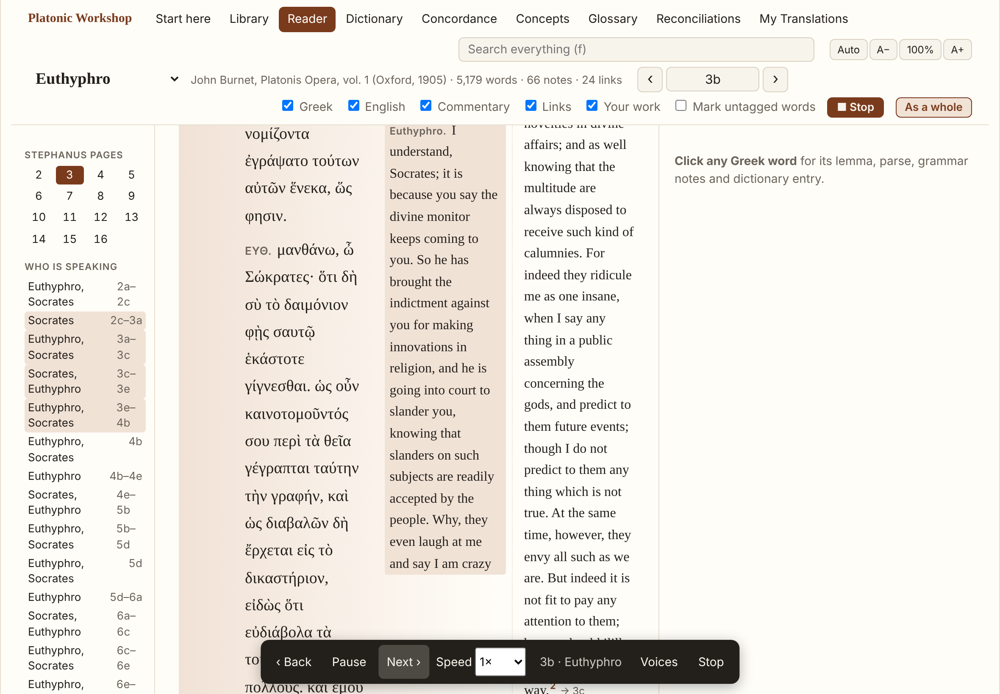

**Milestone 15, English for every piece of Greek: done.** Tap any Greek word anywhere, not only in Burnet's text
(a commentary note, the scholia, an ancient introduction, Taylor's footnotes, a dictionary entry, a quotation), for a
small box with its dictionary form (GLAUx and Morpheus, with Morpheus' short English) and the English Middle Liddell
(or LSJ) prints for it, named; `tools/gloss.py`. The Anonymous Prolegomena, which has no public-domain English, is
translated whole for the Workshop and shown beside Hermann's Greek, labelled *Workshop translation*
(`sources/translations/prolegomena-hermann.json`); Albinus and the Definitions have Burges' English (1854) beside the
Greek (`sources/translations/paired.json`). Under a quotation of Plato's Greek away from the reader, *English* opens
that section in each translation, the Loeb first; Burnet's speaker labels (ΣΩ.) have the speaker's English name
beside them. `tools/greek_audit.py` walks everything the reader is sent and lists every run of Greek, field by field,
with how its English is given ([`reports/greek_audit.md`](reports/greek_audit.md), from
[`sources/translations/coverage.json`](sources/translations/coverage.json)); a test fails if Greek appears anywhere
without an entry there. What is still untranslated is said there: the Greek scholia (milestone 21 of
[`ROADMAP.md`](ROADMAP.md)). Tests in `tests/test_greek_english.py`.

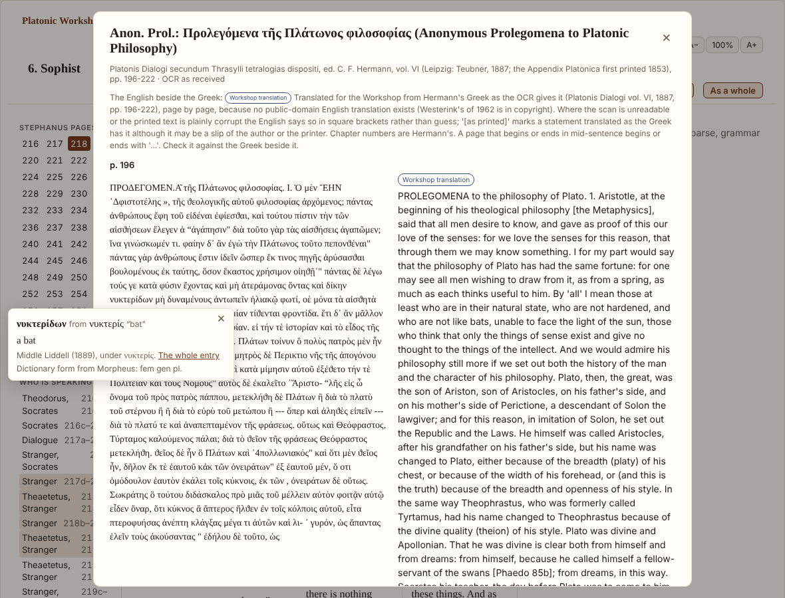

**Milestone 16, plain words and help everywhere: done.** *? Help* at the top of every page, and a small ? beside every
panel (the word box, the dictionary, the translations, the commentaries, the links, your work, the contents, Show, Listen),
says in two sentences what it is for and what to tap, and names the Workshop's own words it uses. *Words used in the
Workshop* (`#words`, linked from every ? and from the Glossary and Start here) explains 23 of them in plain English
(Stephanus, Burnet, Loeb, Taylor, Jowett, LSJ, Middle Liddell, GLAUx, Morpheus, Smyth, Perseus, Beta Code, concordance,
scholia, skopos, tetralogy, the Platonist order, commentary, OCR, ≈ and the rest), each explanation labelled as the
Workshop's own and resting on quoted sources: a file in this folder, the source's own record in the manifest, or a web page
that `tools/webcheck.py --words` fetches and checks (`sources/structure/workshop-words.json`, `-checks.json`). Jargon
in the interface is renamed, with the scholar's name kept on hover: *dictionary form* (lemma), *grammar* (parse),
*Show* (layers), *Words without grammar* (untagged words); Stephanus numbers are explained on hover where they appear.
Every view was walked at iPad sizes (1024×768 and 768×1024, and the iPad Air's 1180×820 and 820×1180) with Playwright;
below 1150px the left contents column, which was simply hidden, now opens from *☰ Contents* at the top left.
Tests in `tests/test_help.py`.

**Milestone 17, key terms linked in the text, opening beside it: done.** The words of Plato and the Platonists (the Good,
the One, intellect, soul, being, the Forms, the Demiurge, the intelligible, procession and return, and the rest) are
underlined in the reader, in the Greek and the English. Tap one: the side panel's *Term* tab says what it is (Taylor's
explanation, a one-line plain meaning labelled as the Workshop's, the definitions), lists every place in Plato it is used,
dialogue by dialogue in the Platonist order, with ‹ › to walk to the previous or next place from where you are, and gives
its key passages, what the Platonists say of it and the related terms. Nothing leaves the page being read: the side panel is
now one place with tabs (*Word*, *Term*, *Notes*, *Links*, *Your work*), and the concept index's page and Taylor's glossary
open inside it too. *Key terms* under *Show* turns the underlines off. See [Key terms in the text](#key-terms-in-the-text)
below and [`reports/terms.md`](reports/terms.md).

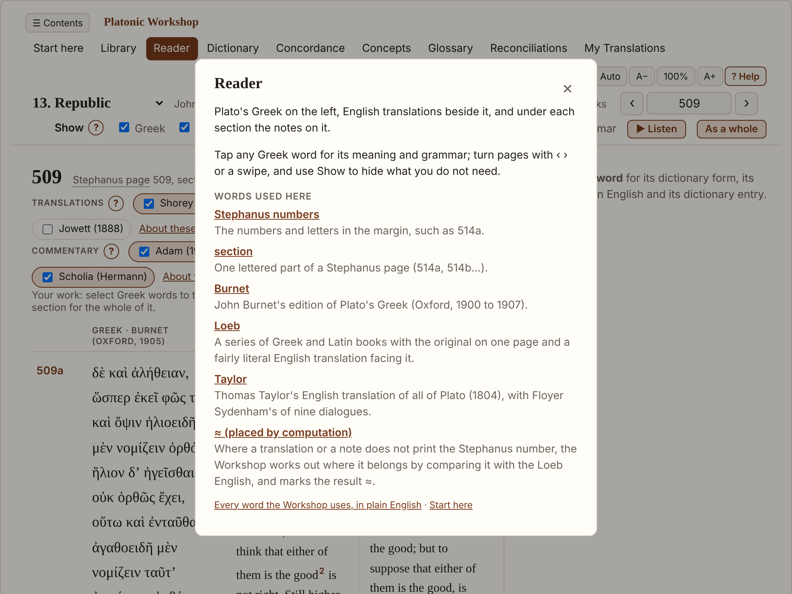

**Milestone 23, the Greek New Testament: done.** The 27 books are on a shelf of their own in the Library (and in the book
picker, after the dialogues), read in the same reader as Plato, a chapter a page and a verse a section (`#john/1:1`): the Greek
of the SBL Greek New Testament (2010, CC BY 4.0) with MorphGNT's dictionary form and grammar for every one of its 137,554 words
(CC BY-SA 3.0), and the American Standard Version (1901, public domain) beside it. Tap a word for the word box as in Plato: its
grammar, Morpheus's every possible grammar, its entries in Middle Liddell and LSJ (a Koine spelling or a deponent is looked up
under the headword the dictionaries use, γινώσκω under γιγνώσκω, and the box says so), how often it occurs in the New
Testament, and how often in Plato, labelled as another corpus. A word of Plato's box shows the New Testament the same way. The
Platonists' key terms are underlined there too, and a term's panel lists its places in the New Testament under its places in
Plato. The Concordance searches either corpus, never both at once; your translations, notes and word studies work on a verse as
on a Stephanus section. Every count of Plato is unchanged: the New Testament's counts and marks are kept in their own tables.
`tools/nt.py`, [`sources/asv-1901/`](sources/asv-1901/README.md), [`reports/nt.md`](reports/nt.md), `tests/test_nt.py`.
Not done: Westcott and Hort's Greek as a second text (optional in the roadmap; no tagged copy with a reuse licence was found to
pin), and the SBLGNT's list of variant readings, whose marks (⸀ ⸂ ⸃) are therefore left out of the text shown.

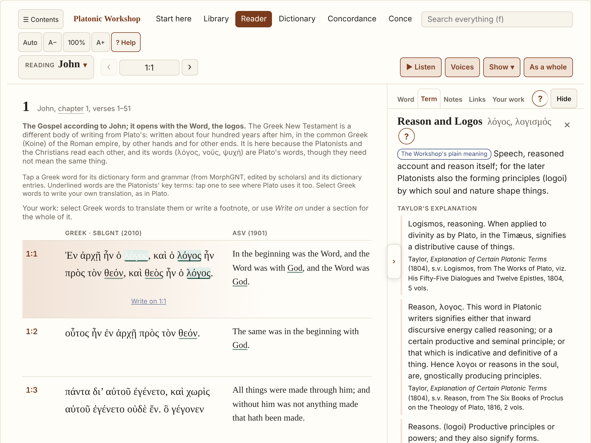

**Milestone 24, modern English of Taylor's Introduction and the Life of Plato: done.** No modern English versions of these
two texts exist, so the Workshop has made them. Every paragraph of Taylor's General Introduction (178) reads in plain modern
English, every idea kept, the long sentences broken into short ones; Olympiodorus' Life of Plato is translated afresh from the
Greek as Hermann printed it (with the opening paragraph Taylor leaves out) and checked against Taylor's translation, and the
Greek of each paragraph is one tap away. Each section opens with a short summary. Taylor's own words are under every paragraph
(*Taylor's words*), or beside it (*Side by side*). The key words are always rendered the same way (Taylor's *intellect* stays
*intellect*, his *ideas* are *Forms*, his *unities* are *henads*, *Jupiter* is *Zeus*), and are underlined to open the Term
tab. Both versions are labelled as the Workshop's own and machine-assisted: they were drafted with an AI model and no scholar
has checked them yet. 59 flags mark hard or disputed places, with Taylor's words and the reason (Taylor's opinions stated as
fact, his misquotations, where the Greek says something his English does not). *Mark a sentence*, under each paragraph, keeps
a sentence that reads badly or seems wrong in your own database, with a comment, for revision; the marks are listed in the
contents column and in the export of Your work. The master copies are plain text, to revise by hand:
`sources/translations/modern/*.txt`; `tools/modern.py` checks them (every paragraph covered once, in order; every flag's words
found in Taylor; the Greek found in Hermann, in order and all of it; the fixed renderings of
`sources/translations/modern/terms.json`) and writes the JSON the reader shows and [`reports/modern.md`](reports/modern.md).
`reader/modern.js`, `tests/test_modern.py`, `tests/modern_browser.js`. Left as Taylor printed them: his footnotes, and the
quotations he translates inside the Introduction (Proclus, Damascius, Simplicius), which are modernised from his English
rather than translated afresh from the Greek (that is milestone 27's work).

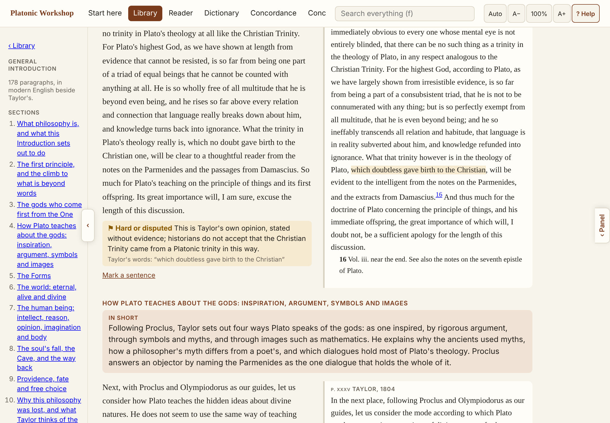

**Milestone 25, the rest of the Neoplatonists: done.** The Library has a shelf of the Neoplatonists' own writings, in Greek,
read whole with contents: the whole of Plotinus (Volkmann, 1883-1884); Proclus on the First Alcibiades (Cousin, 1820-1821), the
Republic (Kroll, 1899-1901), the Parmenides (Cousin, 1821-1827) and the Cratylus (Pasquali, 1908), and the Elements of Theology
(Creuzer, 1822); five works of Iamblichus (On the Pythagorean Life, the Protrepticus, On General Mathematical Science, On
Nicomachus' Arithmetic, On the Mysteries); Damascius on the first principles (Kopp, 1826); Hermias on the Phaedrus (Couvreur,
1901); Olympiodorus on the First Alcibiades (Creuzer, 1821). Fourteen texts, over a million Greek words. Each names its edition
and quotes its licence. Two kinds of text, labelled as such: First1KGreek's corrected TEI (CC BY-SA 4.0), read by the edition's
own divisions with its notes and marginal numbers (Plotinus by Ennead, treatise and chapter, `I.6.9`; Kroll by volume and page);
and the Internet Archive's OCR of public-domain scans, shown as received and not proofread, page by page with the edition's page
numbers (read from the running heads, or counted between them, and marked so), a *See the scan* link on every page, the Latin
pages of the editions folded, and lines that are only specks of the scan hidden but kept (*The OCR as received* shows every line).
Corrections of common misreadings (χαὶ for καὶ, ἐςὶ for ἐστὶ) are kept apart in
[`sources/neoplatonists/corrections.json`](sources/neoplatonists/corrections.json), listed beside each part with the reason, and
applied only in the reading *With corrections*, where each changed word is marked; the text shown is never changed. Every Greek
word can be tapped for its meaning, as everywhere. `tools/neoplatonists.py`, `reader/neo.js`,
[`reports/neoplatonists.md`](reports/neoplatonists.md), `tests/test_neoplatonists.py`, `tests/neo_browser.js`. The scans
(`archive` sources in the manifest) are pinned by sha256; the OCR of the pages read is committed in
`sources/neoplatonists/ocr/`, since the Internet Archive often refuses GitHub's servers, and
`tools/fetch_sources.py --archive` then `tools/neoplatonists.py --extract` remake it from the downloads (a test checks the two agree). Not here, with the reasons
on the shelf and in the report: Olympiodorus on the Gorgias (the full editions, 1936 and 1970, are in copyright) and on the
Phaedo (Norvin's 1913 edition was not found among the scans, and Finckh's 1847 OCR has no Greek letters); Damascius on the
Parmenides, Phaedo and Philebus; the Greek of Proclus on the Timaeus and the Theology (their English is already here).

**Milestone 26, the commentators' Greek beside Taylor's English: done.** Taylor translated three of the texts on the
Neoplatonists' shelf, and each is now read in his English with the Greek one tap away: fifteen treatises of Plotinus (Select
Works, 1817), Iamblichus On the Mysteries (1821) and Proclus' Elements of Theology (1816). The Library lists them under the
Neoplatonists (*Taylor's English beside the Greek*, `#neo-en/taylor-plotinus`); each chapter has a *Greek* button that opens the
Greek it translates beneath it, every word tappable for its meaning (*All the Greek* opens it under every chapter), and the
Greek text links back to Taylor's English of each chapter he translated. Every match says how it was made. Plotinus and
Iamblichus by Taylor's own chapter numbers, which are the Greek editions' (Ficino's chapters, which Volkmann keeps; Gale's,
which Parthey keeps): which treatise of the Enneads each is comes from Taylor's list of Plotinus' books in his Introduction and
from Volkmann's heading, both quoted; numbers the OCR garbled are read from their place, and where the OCR lost one the passage
holds two chapters and says so. The check: chapter by chapter, Taylor's English runs to about the same multiple of the Greek
(1.6 English words to one Greek word in Plotinus, 1.4 in Iamblichus); the few chapters outside half to twice that were read and
are explained in the report. The Elements are harder: Creuzer's Greek is the OCR of a scan and most propositions are not
numbered in it. A proposition is *found* where Creuzer prints its number (in the Greek, or in his Latin on the facing page);
otherwise it is *machine-matched*, placed by its length against Taylor's and kept only where the Greek of most of the terms of
Taylor's statement (*soul* ψυχή, *participates* μετέχει ...) is in its first lines; the rest are *not placed*, and the reader
shows the pages of the Greek between the placed propositions before and after. Taylor's footnotes that quote the Greek are
looked for in the Greek matched. `tools/taylor_greek.py`, [`reports/taylor_greek.md`](reports/taylor_greek.md),
`tests/test_taylor_greek.py`, `tests/taylor_greek_browser.js`. Taylor's English is the Internet Archive's OCR of his books
(the Elements, Project Gutenberg's transcription), not proofread; a long footnote that runs over a page sometimes stays among
the text. Not matched: Taylor's Proclus on the Timaeus and the Theology (no Greek of them is on the shelf), and the extracts
from Synesius in the Plotinus volume.

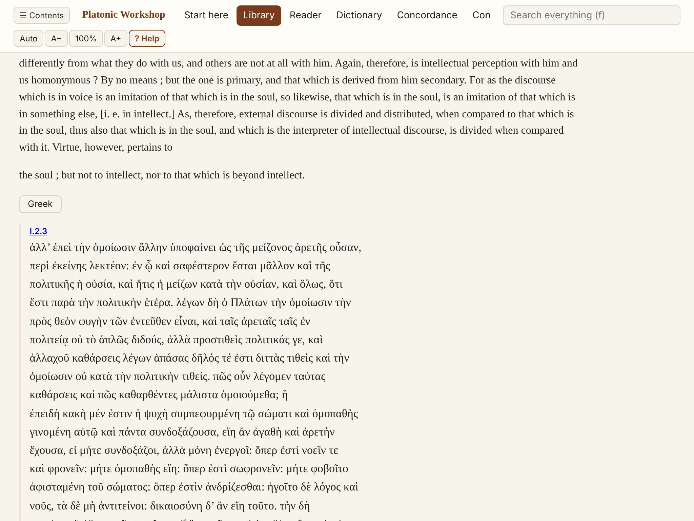

**Milestone 27, modern English of the Neoplatonists: Plotinus done.** The Neoplatonists are being put into plain modern English, made
from the Greek and not from Taylor, so that the modern version does not inherit his oddities; it is checked against Taylor's
English of the same chapter, and where the two differ a flag quotes Taylor's words and says why (329 flags in all: his "rumor
says these are divine", where the Greek says these *men*; his "immateriality", where Volkmann's Greek has "sameness"; questions
he made statements; and the places where his scan prints a footnote into the middle of his text, or loses a line). Done so far:
all fifteen treatises of Plotinus that Taylor translated, in Porphyry's order, 190 chapters, from **I.2 On the Virtues** and
**I.3 On Dialectic**, the first read, to **III.7 On Eternity and Time**, **IV.3** on the soul, **V.1 On the Three
Hypostases** and **VI.9 On the Good, or the One**, which ends the Enneads with "the flight of the alone to the alone". I.2 is where the later
Platonists found the ranks of virtue, civic and then purifying, that their curriculum climbs (the Gorgias "as political", the
Phaedo "as purificatory", Anon. Prol. 26). They open from the Library (under *Taylor's English beside the Greek*) in place of
Taylor's English: each treatise and each chapter has a short title and a summary; every paragraph has its Greek one tap away
(every word tappable), and every chapter Taylor's English (*Taylor's words*), or beside it (*Side by side*), or Taylor alone
(*Taylor only*). The key words are always rendered the same way (νοῦς *intellect*, σωφροσύνη *self-control*, πολιτικὴ ἀρετή
*civic virtue*, ἐπιστροφή *turning*), and are underlined to open the Term tab; Plato's words that Plotinus quotes are noted with
their place, and a test finds them in Burnet's Greek. Labelled as the Workshop's own and machine-assisted, as in milestone 24,
and *Mark a sentence* works the same way, the marks kept in your own database and in the export. The master copy is plain text,
to revise by hand: `sources/translations/modern/plotinus.txt`; `tools/modern_neo.py` checks it (every chapter of each treatise
once, in order; every paragraph's Greek found in its chapter, in order, so that all of it is covered; every flag's words found
in Taylor's chapter; the fixed renderings of `sources/translations/modern/terms-greek.json`) and writes the JSON the reader
shows and [`reports/modern_neo.md`](reports/modern_neo.md). `reader/neo.js`, `tests/test_modern_neo.py`,
`tests/modern_neo_browser.js`.

Proclus on the First Alcibiades (the dialogue read first) is in modern English too, so far his prologue, his notes on the
wording of the dialogue's first words (103a), his account of love that follows them, why Socrates loved first and stays (Socrates as the young man's good daemon and only lover), daemons in general and Socrates' own daemon, and the dialogue's next words down to 105a (Cousin's vol. II p. 297), at
`#neo-modern/proclus-alcibiades`, made from Greek proofread first: Cousin's 23 pages of the prologue were proofread line by line
from the page images into a master copy, `sources/neoplatonists/proofread/proclus-alcibiades.txt` (and the 16 pages of the
notes on the first words after them, the 12 pages on love, 18 more on Socrates as a good daemon and the only lover, 4 on the more secret account of love, 9 on the crowd and Socrates' silence, 10 on the daemonic opposition, 100 more, pp. 185-289, on the daemons and the next words of the dialogue, and 8 more, pp. 290-297, on the nature worth loving; three pages the scan lost are proofread from another scan of the
same volume and marked so), and `tools/proofread.py`
writes each line the OCR misreads (or drops) as a correction in `sources/neoplatonists/corrections.json`, for that page only,
checking that every page then reads as proofread. The OCR is still shown as received; *With corrections* reads the proofread
page, and each page links to its section in modern English. The eighty-four sections are checked against Taylor's Introduction to the
dialogue and his notes, which are drawn from Proclus (*Taylor's words*, *Side by side*, each paragraph or note named); each paragraph's Greek names its pages and their
scans. `tests/test_proclus_alcibiades.py`, `tests/proclus_alcibiades_browser.js`. Next, in later sessions: the rest of Proclus
and Olympiodorus on the First Alcibiades, proofread first in the same way, then Iamblichus and the others.

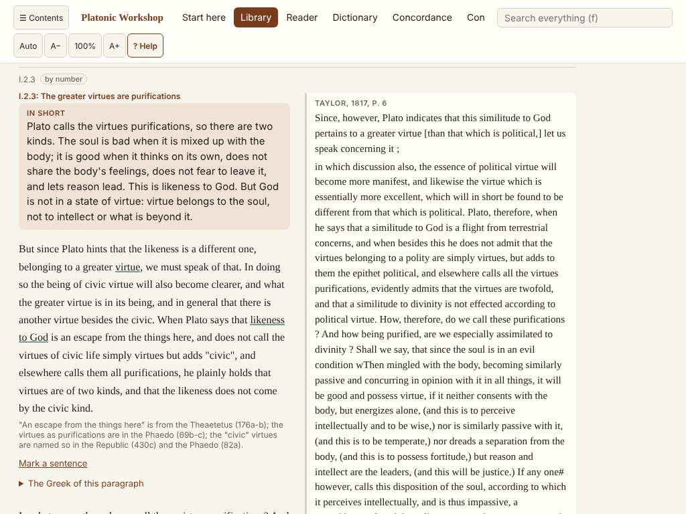

**Milestone 35, modern English of Aristotle: the Categories (35a), On Interpretation (35b), the Prior Analytics (35c) and Books Α to Θ of the Metaphysics (35m1 to 35m5) done; the current focus, with work on Plato and the Neoplatonists paused (November 2026).** Aristotle is being put into plain modern English, in the
Platonists' order of reading, one work or group of works a session (the sub-milestones 35a to 35n are in the ROADMAP). Where
public-domain English is on the shelf, the modern version modernises it, checked sentence by sentence against the Greek, and
follows the Greek where they differ; where there is none, it is made fresh from the Greek. First, the **Categories**, the first work
the Platonists read after Porphyry's Introduction: all fifteen chapters, 66 paragraphs, modernised from Edghill's Oxford English
(1928) against Bekker's Greek, and compared with Taylor (1812) and Owen (1853). Where an older English says something the Greek
does not, a flag quotes it and says why (12 flags: Taylor's "reason of essence" for the account of a thing's being; his "nor is any
subject", where the Greek says "nor is *in* any subject"; Edghill's clause from another text of the Greek; Taylor's own note read
into his text by the scan). It opens at `#neo-modern/aristotle-categories`, linked from the Aristotle shelf and from the work's
contents column, on the page of milestone 27: each chapter has a short title and a summary, each paragraph its Greek and its Bekker
columns a tap away (each column opens the work there), each chapter Taylor's English (*Taylor's words*, or *Side by side*), and
*Mark a sentence* works the same way. Labelled as the Workshop's own and machine-assisted. The master copy is plain text:
`sources/translations/modern/aristotle-categories.txt`; `tools/modern_ar.py` checks it (every chapter of the Greek once, in order;
every paragraph's Greek found in its chapter, in order, with the columns it lies on; every flag's words found in Taylor's chapter
or in another English of the work on the shelf; the fixed renderings of `terms-greek.json`) and writes the JSON the reader shows and
[`reports/modern_ar.md`](reports/modern_ar.md). `tests/test_modern_ar.py`, `tests/modern_ar_browser.js`. Then **On Interpretation** (35b), the second work read: all fourteen
chapters, 45 paragraphs, modernised from Edghill against Bekker's Greek (following the Greek, with Owen and Taylor beside it, where
the OCR of Edghill's pages has lost a passage), with 11 flags: Taylor's "passions of the soul", "from compact", "illiterate sounds"
and "energies"; Edghill's "actually true or actually false" in the sea battle chapter, where the Greek says "not yet true or false";
his "every man is not" for "not every man is"; and his "primary substances" for the first, always actual substances of chapter 13.
It opens at `#neo-modern/aristotle-on-interpretation`. Then the **Prior Analytics** (35c), the third: both
books, all 73 chapters, 202 paragraphs, modernised from Jenkinson's Oxford English (1928) against Ross's Greek, with 18 flags, among
them Jenkinson's "perfect" syllogism (the Greek says "complete") and "False cause" (the Greek says "not because of this"), and
Taylor's "be present with", "an imbecile syllogism", "abduction" (for what is now called reduction) and "consentaneous" (for
"likely"). Each chapter is headed by its book, and *Side by side* shows Taylor's own chapter, which in Book II is often numbered
differently. It opens at `#neo-modern/aristotle-prior-analytics`. Then, moved ahead of the rest at Daniel's asking, the
**Metaphysics**, done a few books at a time (35m1 to 35m8 in the ROADMAP, one thread each). First Books **Α and α** (35m1): all
13 chapters, 67 paragraphs, modernised from Ross's Oxford English (1908) against Ross's own later Greek (Oxford 1924, from
Perseus), with Taylor (1801) beside it, and 14 flags: among them Ross's "reason" for νοῦς (the modern version says "intellect"
throughout, as in "as the eyes of bats are to the light of day, so is the intellect of our soul"), his "essence" for τὸ τί ἦν
εἶναι ("what it is to be"), his "musical scale" for the Pythagoreans' ἁρμονία, and Taylor's "species of matter" and "phantasm";
and Taylor's own note that Aristotle answers the words of the earlier philosophers and not their meaning. Notes give the places
in Plato that Aristotle answers, and say where the Platonists replied (Syrianus on Books Μ and Ν). Chapters are headed by the
book's letter ("Book Α (I), chapter 9"), and *Side by side* shows Taylor's own chapter: his Book Α has seven chapters, not ten.
It opens at `#neo-modern/aristotle-metaphysics`. The master copy grows by books: `"done_books"` in `tools/modern_ar.py` names the
books done, and the check wants every chapter of those books. Then Books **Β and Γ** (35m2): the fourteen puzzles
that Aristotle sets before the science he is seeking ("one cannot untie a knot one does not know"), and the science of being as
being, with the principle of non-contradiction ("the same thing cannot at the same time belong and not belong to the same thing
in the same respect") defended against Protagoras and the Heracliteans; 14 chapters, 67 paragraphs, 26 flags, among them Ross's
"mythologists" for Hesiod's θεολόγοι (the Platonists' "theologians"), his "negatively" for showing by refutation, and Taylor's
"energy" for actuality. The notes say where the later books answer each puzzle, and where Plato (the Theaetetus, the Sophist)
says the same. Taylor's Book Γ has seven chapters, not eight. Then Book **Δ** (35m3), Aristotle's lexicon of philosophy:
thirty short chapters, each a word the inquiry uses and the ways it is said, from "principle", "cause", "element" and "nature"
to "one", "being", "substance", "potency", "quality", "relative", "complete", "limit", "whole", "genus", "false" and
"accident"; 30 chapters, 74 paragraphs, 52 flags, among them Ross's "beginning" for ἀρχή, his "prime mover" for the begetter,
"formula", "concept" and "conception" for λόγος, "scandal-monger" for the informer and "sketch" for shadow-painting, and Taylor's
"free-will" for choice and "passion" for affection. The OCR of Ross has lost lines in nine of the thirty chapters; the modern
version follows the Greek there, and says so. The notes give the Platonists' readings (the One as measure, the Good, limit and
the unlimited, the prior that can be without the posterior). Taylor's chapters of Book Δ are Bekker's. Then Books **Ε and Ζ**
(35m4): the three theoretical philosophies, mathematics, natural science and theology, the first of them universal because it
is first; being by accident and being as true set aside; and the inquiry into substance at the centre of the work: what it is to
be, coming to be by nature, art and chance ("man begets man"), the parts of the definition and of the thing, the argument that
no universal is substance and that the Forms, taken as separate universals, are not substances (the "third man"), and substance
as the cause by which the matter is some definite thing, the form. 21 chapters, 79 paragraphs, 50 flags, among them Ross's
"what we may call theology", "the Idea of good" and "the ideal animal" for "the good itself" and "animal itself", "complete
reality" for actuality, "abstract linguistic" for arguing about words, and Taylor's "very nature of a thing" for what it is to
be, "essence" for substance, "paradigm", "from equivocals", and his long note on matter, after Plotinus, which the scan reads
into VII.3. The notes give the Platonists' answers to Ζ 13-16. Taylor's Book Ε has three chapters and his Ζ sixteen; each
chapter names his. Then Books **Η and Θ**
(35m5): sensible substance as matter and form, read as potency and actuality, and the puzzle of Book Ζ solved, that the last
matter and the form are one thing, the one in potency and the other in actuality; then potency and actuality themselves:
powers with reason and without, the Megarians answered, actuality grasped by analogy and set apart from motion ("at the same
time one sees and has seen"), actuality prior to potency in account, in time and in substance, the sun and stars that never
tire, no evil in the eternal things, and being as true, where the simple is known by touching it. 16 chapters, 47 paragraphs,
44 flags, among them Ross's "complete reality" for actuality, "organic unity", "rational formula", "will" for choice, "the
Idea of science", "the eternal prime mover", and Taylor's "energy", "transcendency" for excess, "impotency", "ablation" and
"free-will". The notes give the Platonists' readings (Plotinus on what is in potency and in actuality, Proclus on evil and
on participation). Taylor's chapters are Bekker's. Next: Books Ι and Κ (35m6).

**Aristotle, milestone A1: the Metaphysics and the Nicomachean Ethics: done.** Aristotle has a shelf of his own in the Library
(`#metaphysics`, `#nicomachean-ethics`), read in the same reader as the dialogues, at Bekker's pages and columns (980a: page 980,
left column, as every book on Aristotle cites him; type `1072b` in the box). The Greek is Ross's Metaphysics (1924) and Bywater's
Ethics (1894) from Perseus, every word tagged by GLAUx as Plato's are, with the tap-a-word box, Middle Liddell and LSJ. Beside it,
side by side: the Loeb English (Tredennick, Rackham) with its notes; for the Metaphysics, W. D. Ross's Oxford translation (1908),
placed at the 184 Bekker columns read from his margin, and Thomas Taylor's (1801), placed by alignment (≈) with the books and
chapters as fixed points, with his 566 notes from Alexander, Syrianus and the other Greek commentators under the text; for the
Ethics, Chase (1847, Gutenberg, ≈). Taylor's Introduction to the Metaphysics and his Additional Notes on the Ideas read whole
(`#taylor/metaphysics-introduction`). The Platonists' key terms are underlined in the Greek, and a term's panel shows Aristotle
after Plato; Aristotle's marks are kept apart (`ar_term_hit`) so that every count of Plato stays Plato's. The scans are read by
`tools/aristotle_ocr.py` (their OCR, with each word's place on the page, committed in `sources/aristotle/ocr/`; margins and footnotes
told by their place and type size; Taylor's long s read as in milestone 6) and built by `tools/aristotle.py`;
[`reports/aristotle.md`](reports/aristotle.md), `reader/aristotle.js`, `tests/test_aristotle.py`. The plan for the rest of
Aristotle (A2 to A8: Taylor's Dissertation and the Platonists' order of reading, the De Anima and Physics, the Organon and
Porphyry, the Greek commentators, Syrianus on the Forms in English, Plato and Aristotle together) is in the ROADMAP.

**Aristotle, milestone A2: Taylor's Dissertation and the Platonists' order of reading: done.** *Start here* for Aristotle
(`#aristotle`) gives, in Taylor's words, why the Platonists read Aristotle before Plato (Marinus on Proclus), the order of his works
from logic to theology and the end they lead to, how he writes, and where he agrees with Plato "in names only, and not in things",
each passage checked against the scan. Taylor's Dissertation on the Philosophy of Aristotle (1812) reads whole
(`#taylor/aristotle-dissertation`), its fifty chapters in the contents column, cleaned from the Archive's scan by
`tools/aristotle_dissertation.py` (Taylor's quotations from Aristotle and the commentators kept as quotations, the footnotes under
the paragraphs they belong to).

**Aristotle, milestone A3: the Physics, On the Heavens and On the Soul: done.** The three works of nature and the soul, Greek
from First1KGreek (Ross's Physics and De Anima, Prantl's De Caelo; CC BY-SA 4.0) at Bekker's columns, every word tagged from
GLAUx, with English beside it from the Internet Archive's scans, cleaned by rule and not proofread: Hardie and Gaye's Physics
(1930), Stocks's On the Heavens (1922) and Hicks's On the Soul (1907). Each column the translator prints (or, for Hicks, heads a
page with) is a fixed point; the columns between are placed by length and marked ≈ (`tools/aristotle_trans.py`).

**Aristotle, milestone A4: the Organon: done.** The Categories, On Interpretation, Prior and Posterior Analytics, Topics and
Sophistical Refutations, in Greek (First1KGreek: Ross's Analytics; Bekker's text of the rest) with every word tagged from GLAUx, and
the Oxford English of 1928 beside it, read from the scan's margin at Bekker's columns (`tools/aristotle_organon.py`). Where the
Greek does not print the Berlin columns they are carried over from the English, chapter by chapter, and marked so (≈).
Owen's English of 1853 is a second translation of all six treatises, at the Oxford's columns carried over chapter by chapter (≈,
`tools/aristotle_owen.py`). Porphyry's Introduction (Isagoge), which the Platonists read before any Aristotle, opens the logic: Owen's English (1853), read
whole with his notes (`tools/aristotle_porphyry.py`), and Busse's Greek (1887) on the Neoplatonists' shelf.

**Aristotle, milestone A5: the Greek commentators: done.** Thirty-four commentaries of the Berlin *Commentaria in Aristotelem
Graeca* (1882-1909), from Alexander of Aphrodisias to Simplicius, Philoponus, Syrianus, Asclepius, Olympiodorus, Elias and David,
with Alexander's own On the Soul and its Mantissa, in First1KGreek's corrected Greek (CC BY-SA 4.0), on their own shelf under
Aristotle and read by the pages of the Berlin edition (`tools/aristotle_commentators.py`). Each page links to the columns of Aristotle
it comments on, and each column lists the commentators' pages on it: where the editor prints the Bekker reference in the margin,
or (≈) where the page repeats runs of words found in that column alone. What was read, and what the files lack, is in
`reports/commentators.md`.

**Aristotle, milestone A7: Plato and Aristotle together: done.** The concordance takes Aristotle as a corpus of his own
(*Search Aristotle*: 5,418 dictionary forms), and a word's panel shows it in the other philosopher. *Aristotle on Plato*
lists every place his Greek names a dialogue or Plato, or a translator's note on the column cites a passage of Plato (186
places, 18 dialogues), linked both ways: a section of Plato shows where Aristotle discusses it (`tools/aristotle_plato.py`).
*Plato and Aristotle reconciled* quotes the commentators, in their Greek, on where the two agree (the Forms, the soul, the
eternity of the world, God as maker), each passage checked against its page; the English is the Workshop's own, labelled so.

**Aristotle, milestone A8 (done): Taylor's own translations, and the rest of Aristotle.** Thomas Taylor's Categories, On Interpretation and
Prior Analytics (Works of Aristotle, vol. I, 1812) and his Nicomachean Ethics (1811) are shown beside the Greek as *Taylor
(1812)* and *Taylor (1811)*, read from Google's scans in the Internet Archive by the rules that read his Metaphysics
(`tools/aristotle_taylor.py`), with his notes from Simplicius, Ammonius and the other commentators under the text. They print
no Bekker numbers, so the Organon is placed at the Oxford's columns carried over chapter by chapter, and the Ethics against
the Loeb English (≈). OCR cleaned by rule, not proofread. Five more works come from Perseus with their Loeb English, each
GLAUx-tagged: the Eudemian Ethics, Politics, Economics, Rhetoric and Poetics; Taylor's Rhetoric and Poetic (1811) are beside
the last two. Seven more are in Greek only, from First1KGreek, GLAUx-tagged, with no English yet: the Magna Moralia,
Generation and Corruption, Meteorology, and Parts, Progression, Movement and Generation of Animals. The Parva Naturalia (eight
short treatises, from On Sense to On Respiration) are in Greek only too, Bekker's Oxford text, which prints no Berlin columns: these
are carried over word by word from the margin of Biehl's Greek (Teubner, 1898). The History of Animals has D'Arcy Thompson's Oxford
translation (1910) beside it, its columns carried over from his margin chapter by chapter (≈). The minor and spurious works
are in Greek only too (A8e): the Mechanics and On Indivisible Lines (the mathematical works, in Taylor's division), On Melissus,
Xenophanes and Gorgias, On Colours, On Things Heard, the Physiognomics, On Plants, On Marvellous Things Heard, the Winds, the
Problems, On Breath, and the other versions of Physics VII and of On the Soul II, at the Berlin columns First1KGreek marks in them.
GLAUx tags all but On Things Heard, On Indivisible Lines and the Winds, whose words carry Morpheus's parses only.
The last four (A8f): On Virtues and Vices, in Bekker's Greek from Perseus, which has no English for it; and three works Bekker did
not print, each cited by its own numbers: the Constitution of the Athenians in Kenyon's Greek (1920) by chapter and section
(42.1), with Kenyon's English beside it (Project Gutenberg); the Letters (Hercher, 1873) by letter; and the Divisions
(Mutschmann, 1906) in both his texts, Diogenes Laertius' and the codex Marcianus', by his numbers (Diogenes 5, Marcianus 58).

## Running it

Python 3.10 or later, standard library only. Nothing to install. One command does everything:

```sh
cd platonic-workshop
python3 workshop.py                 # downloads the sources if needed, builds the library if needed, opens the reader
```

The first run downloads about 640 MB into `data/` (not committed, two minutes) and builds the library
(about four minutes); after that it starts at once, and rebuilds only when something the library is built
from has changed. `--rebuild`, `--no-build`, `--port` and `--no-browser` do what they say. The steps by hand:

```sh
python3 tools/fetch_sources.py      # about 640 MB into data/ (not committed), 2 minutes
python3 tools/build_db.py           # builds data/workshop.sqlite, all 36 works, about four minutes
python3 tools/serve.py              # then open http://localhost:8800/
```

Taylor's volume I is already imported into `texts/`. To rebuild it from the saved pages,
run `python3 tools/import_taylor_vol1.py` (seconds). `tools/fetch_theosophylib.py`
downloads the theosophylib.com pages again; it is not needed for the import, which works
from the committed copies.

### On the iPad (or any browser, no computer needed)

Open **https://danoc505.github.io/DeckardsMusicBox/** in Safari. To keep it on the home screen,
tap the Share button, then *Add to Home Screen*. The first opening takes up to a minute; after
that it opens quickly, and pages already read open without the internet.

- Swipe left or right across the text to turn the Stephanus page. Tap a word for the word box;
  to take in several words, press and hold on the first and drag the handles.
- **Reading** at the top left opens *Choose what to read*: every dialogue as a tile (each opens
  where you last were in it), a box to find one by name, the translations shown beside the Greek,
  and the translation read aloud. **Show** holds the switches for what the page shows, with
  *Just the text* and *Everything*. The contents column and the side panel fold away with the tab
  on their edge (the panel's *Hide* does the same), and come back with the same tab; a tap on a
  Greek word or a key term opens the panel again.
- **Voices** (beside Listen) chooses a voice and a pitch for each person, or one voice for
  everyone, the speed, and which translation is read, at any time: picking a voice says a line of
  that person's in it, and *Try* says it again. Reading aloud pauses while you try voices and
  goes on when the window is closed. While reading, tap any paragraph of the translation being
  read to go on from there. More voices come from Settings › Accessibility › Spoken Content ›
  Voices on the iPad.
- Your translations and notes are kept on the iPad itself, separately from the laptop's
  `data/user.sqlite`. *Export* saves them as Markdown, JSON or a copy of the database.
- The website is the same reader answered by the same `tools/serve.py`, run inside the browser
  by Python compiled for the web (Pyodide), over the library database cut into small compressed
  pieces that are fetched only when read. `web/` holds the parts only the website uses.
- GitHub rebuilds and republishes it by itself after every change to the Workshop on `main`
  (`.github/workflows/platonic-workshop-site.yml`, the one file outside this folder; it takes about
  ten minutes). To try the website on this computer: `python3 tools/build_site.py --serve`.

`python3 tools/build_db.py tlg031` builds only the Timaeus (or any list of Perseus work ids).
`tools/verify_sources.py` re-runs milestone 1's checks, and
`python3 -m unittest discover -s tests -v` runs all the tests.

## The reader

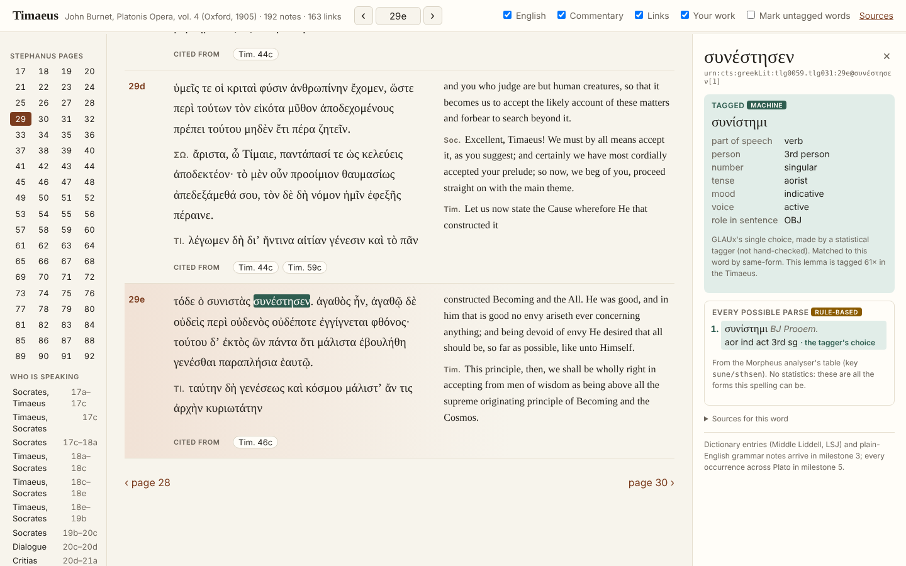

- **Navigation.** Pick a dialogue from the menu at the top left (grouped by Thrasyllus'
  tetralogies). Type a reference (`29e`, or a page, `52`) in the box at the top, or a work and a
  reference (`Rep. 514a`, `Phdr. 246`, `laws 700`), use ‹ › or the arrow keys to turn Stephanus
  pages, or pick a page in the left column. The address bar follows you
  (`http://localhost:8800/#republic/514a`), so a place can be bookmarked; an address from
  milestones 2 to 4 (`#29e`) still opens the Timaeus.
- **Text.** Burnet's Greek on the left, Bury's Loeb English (1929) on the right, section
  by section. Words Burnet brackets as spurious keep his square brackets.
- **Words.** Click any Greek word. The green box is GLAUx's single tagged choice of lemma and
  parse, marked *machine*: it was assigned by a statistical tagger and nobody has checked it.
  Under it, every parse the rule-based Morpheus analyser allows for that spelling; the
  one that agrees with the tag is highlighted, so you can see at a glance what else the word
  could be. The word's CTS address is shown for citing. *Mark untagged words* underlines the
  few words GLAUx has no match for.
- **Commentary.** Bury's 192 footnotes, numbered in the English and printed under their section.
  Each says how it was anchored and its proofreading status.
- **Links.** *Points to* lists the passages a note cites; *Cited from* lists the notes, in any
  dialogue, that cite this passage. Every one opens the passage, in whichever dialogue it is.
  So do the citations of Plato in LSJ's entries.
- **Who is speaking.** The left column lists the speeches, from the speaker markup in the Perseus text.
- **Your work.** Your translations and notes under each section, and the words they are on
  underlined in the Greek. See [below](#your-translations-and-notes).
- **Sources.** The *Sources* link lists every source in the library with its provenance, licence and commit.

Each layer can be switched off at the top; the choice is remembered in the browser.
The server listens on 127.0.0.1 only.

## All of Plato

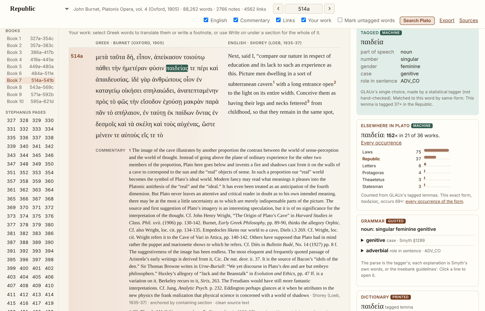

All 36 works of the Thrasyllan tetralogies are in the library, from the same pinned sources as the
Timaeus, built the same way: 561,505 Greek words in 8,552 Stephanus sections, 99.85% of them tagged
by GLAUx, 4,387 Loeb notes (Fowler, Lamb, Shorey and Bury) and 4,841 references read from them.
[`reports/corpus.md`](reports/corpus.md) gives the figures for every work, written by the build itself.

- **Books and letters.** The Republic and the Laws list their books in the left column, the Letters
  each letter, from the book and letter divisions of the Perseus text.
- **Speakers.** The Greek text names its speakers in Greek. Each is given the English name the
  Loeb translation of the same work uses: where a section has the same number of changes of speaker
  in both files, the names are paired in order, and each Greek name takes the English name it is
  paired with most often. A name that never pairs keeps its Greek form. The pairs found are in the report.
- **References between dialogues.** The note-reading rules of milestone 2 now know the titles the
  other translators use (*Prot.*, *Politicus*, *Epist.*…), and a bare reference (`cf. 509 B`) is
  read as the note's own dialogue when the page is one of that dialogue's pages. Shorey's notes on the
  Republic alone give 4,562 references, 1,817 of them within the Republic and 585 to the Laws.
- **Speed.** Each dialogue opens with one request for its outline; each Stephanus page is loaded on
  its own. A page of the Laws comes back from the library in under 10 ms.

## Historical translations

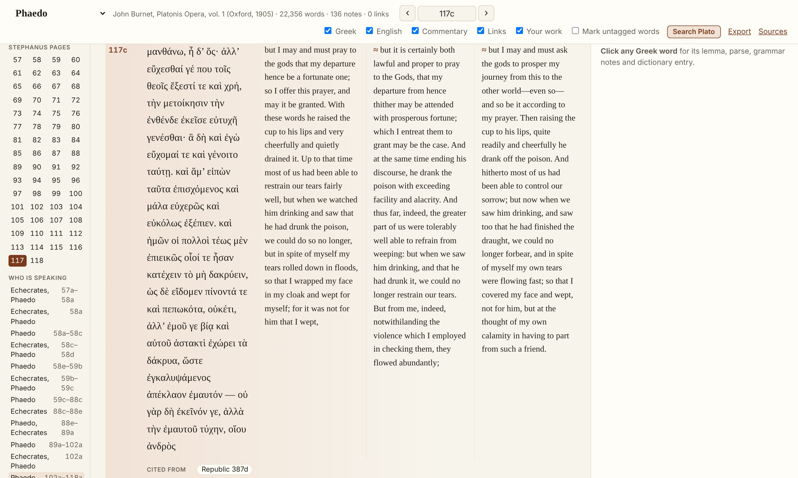

The bar above each page lists the English translations of the dialogue; tick the ones to read side
by side (the Loeb and Taylor by default; the choice is remembered). *About these translations* gives
each one's translator, printing, proofreading status and how it is placed.

| Translation | Works | Where from | How it is placed |
|---|---|---|---|
| The Loeb (Fowler, Lamb, Shorey, Bury) | 36 | Perseus TEI | Stephanus sections as printed |
| Taylor (1804), vol. I: First Alcibiades, Republic | 2 | theosophylib.com corrected text | Stephanus sections as printed there |
| Taylor (1804), vols. II–V | 34 | OCR of the 1804 printing, cleaned by rule (`tools/taylor_ocr.py`) | Computed ≈ |
| Jowett, Republic (3rd ed., 1888) | 1 | Project Gutenberg 55201 | Sections as printed |
| Jowett, Dialogues vol. II (1892): Euthyphro, Apology, Crito, Phaedo, Gorgias, Meno, Lesser Hippias, Alcibiades I and II, Menexenus | 10 | Project Gutenberg 76464 | Page printed, section computed ≈ |
| Jowett, the others he translated | 17 | Project Gutenberg (`sources/jowett-gutenberg/ebooks.json`) | Computed ≈ |

- **Who translated what.** Taylor's General Introduction (vol. I, pp. cv–cvi) names Sydenham's nine:
  the First and Second Alcibiades, the Greater and Lesser Hippias, the Banquet except the speech of
  Alcibiades (which is Taylor's), the Philebus, the Meno, the Io and the Rivals. Those editions say
  "Sydenham (1804)", the Banquet "Sydenham and Taylor (1804)" with each paragraph's translator, and
  their notes are attributed by Taylor's signatures S. and T. Jowett's Alcibiades II is Matthew
  Knight's, as Jowett says. Jowett did not translate the Greater Hippias, Hipparchus, Rivals, Theages,
  Clitophon, Minos, Epinomis or the Letters.
- **Taylor's OCR.** The scans of vols. II–V read the long s as f, the ct ligature as d, and misread
  letters. `tools/taylor_ocr.py` tries those readings on every word and keeps one only if it is a word
  of English (from Taylor's own vol. I, Jowett and the Loeb), choosing by the words around it when two
  are; running heads, catchwords and page signatures are removed, footnotes are kept as Taylor's notes.
  About 15% of words were changed; unknown words are left as printed. Each paragraph keeps the OCR as
  received (*Show the OCR*). Figures in [`reports/taylor_ocr.md`](reports/taylor_ocr.md). The
  Timaeus scan stops at about 89e. Proofreading status: *OCR cleaned by rule*.
- **Computed placement** (`tools/align.py`). No AI: words rare in both texts (names, numbers, unusual
  nouns) pair a sentence of the translation with one of the Loeb, which knows its sections; the
  longest consistent chain of pairs is kept, and positions in between are interpolated. Printed page
  numbers are fixed anchors. A paragraph that spans more than two sections is cut at the sentence
  where its section changes; otherwise it is shown whole where it begins, with → and its last section.
  Tested where the numbers are printed: Taylor's Republic and First Alcibiades 87% of sentences in the
  right section, 97% within one; Jowett's Republic 85% and 97%; Jowett's vol. II 95% on the right page.

## The commentaries

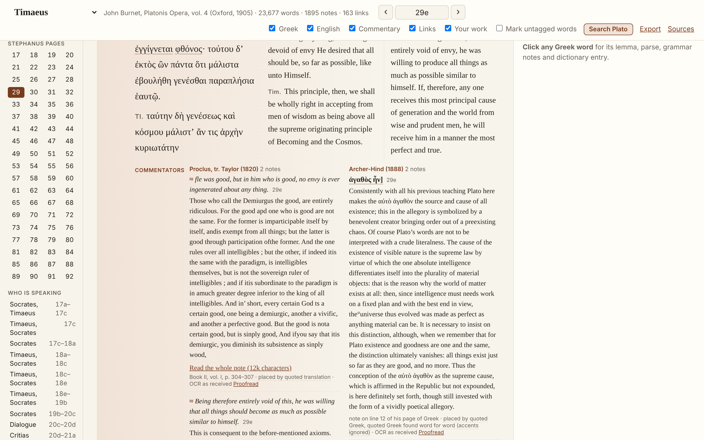

- **Under each section**, a column per commentator on it (tick which ones in the *Commentary* bar). A long
  note (Proclus runs to pages) opens with its first paragraphs; *Read the whole note* brings the rest.
- **On the words.** A note that quotes Greek is on those words: they are dotted in the text, light up when
  you point at the note, and the word box lists *Commentary on this word*. Click a Greek lemma to find it.
- **How each note is placed** is under it (hover for the evidence), and ≈ marks a computed place:

| Commentary | Notes | How they are placed |
|---|---:|---|
| Archer-Hind (1888), from the Internet Archive OCR | 823 | He quotes the Greek at the head of each note (`4. εἰς γυναικὸς φύσιν]`). The words are found in Burnet's text: first the lemmata found at one place only and in the order of the notes, then each of the rest between those. 688 found word for word (accents ignored), on those words, not computed; 106 found in part (≈); 29 not found, placed with the note before (≈). Checked against his own page heads: 98% fall on the page he prints them on. |
| Proclus, tr. Taylor (1820), from the Internet Archive OCR | 254 | Proclus quotes the dialogue a passage at a time in Taylor's translation. Each quotation is found in Taylor's 1804 translation, whose sections `tools/align.py` computed (milestone 6), so every place is ≈. Only quotations that follow one another in the dialogue are taken as lemmata. The preface on the scope of the dialogue is with the introductions. |
| Taylor, Additional Notes from Proclus (1804) | 7, and 48 footnotes | Each names a page of Taylor's translation and quotes it; found there (≈). Two lemmata are too badly read to find and are placed with the note before. |
| Introductions: Taylor (1804), Archer-Hind (1888), Jowett (1892) | 133, 172, 181 paragraphs | On the whole dialogue: *Introductions* in the Commentary bar. |

- **Read a commentary straight through**: *About the commentaries*, then *Read it straight through*; each note
  links to its passage.
- **Proofreading.** *Proofread* under any note opens its text beside the OCR as received. Save it as
  *checked*, or with your correction, or as *needing correction*. The library is never changed: your marks
  are rows in `user.sqlite` (table `proofreading`, only ever added to), shown in place of the imported text
  with the original one click away, and included in the exports. If a rebuild changes a note you marked,
  the mark says so.
- **Rebuilding.** `python3 tools/fetch_commentaries.py` downloads the OCR again (the copies in `sources/` are
  committed); `python3 tools/commentary.py` reads the books into `texts/commentary/timaeus/` (committed,
  reviewable); `tools/build_db.py` places the notes and writes the report.

## The citation web

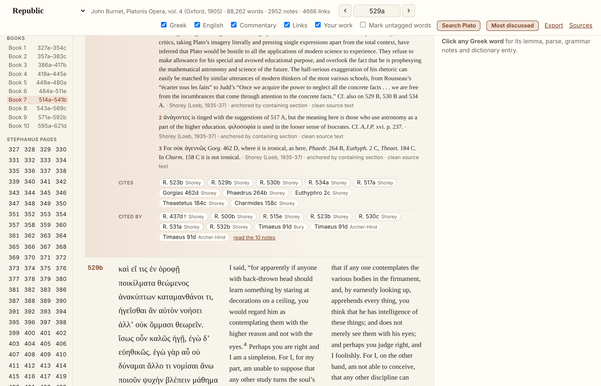

- **Under each section.** *Cites*: every passage its notes cite, in this dialogue or another, each chip with the
  commentator's name; *Cited by*: every note, in any dialogue, that cites this section (or its whole page). Hover a
  chip for the words in the note it was read from and how it was read; *read the notes* opens all of them, the
  reference marked in each, with the whole note one click away. A dialogue named without a page (Taylor's
  "as it is said in the Phaedrus") is a chip for the whole dialogue.
- **Most discussed** (top right): the passages ranked by the number of notes citing them, each note counted once,
  with how many commentators and dialogues the citations come from and how many notes are written on the passage
  itself. Choose a dialogue, a commentator, *only from notes on other dialogues*, and whether uncertain readings
  count. The left column of the reader says how many notes on other dialogues cite the one you are reading, and
  how many name it.

  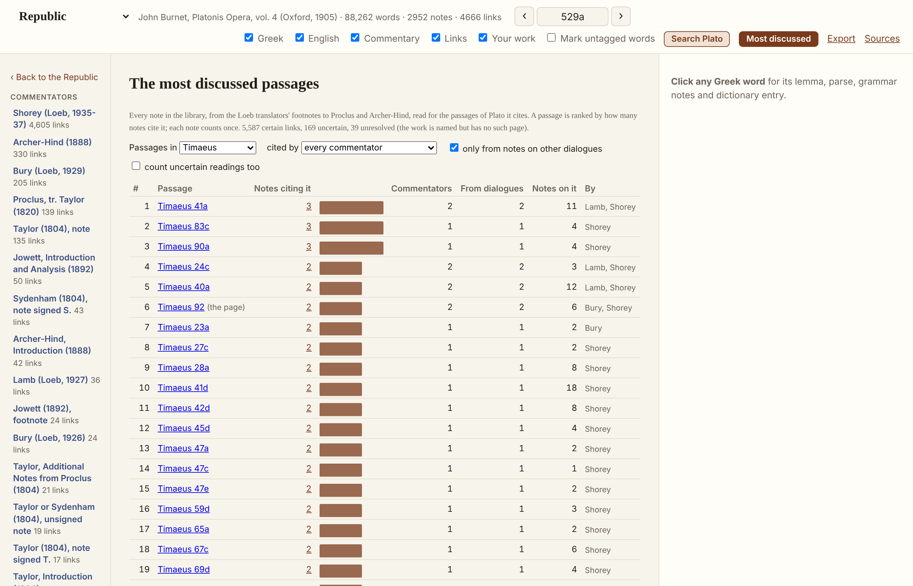
- **How references are read** (`tools/citations.py`, no AI): a title of one of Plato's works (full, abbreviated,
  Taylor's *Banquet*, Latin *Legg.*) followed by Stephanus numbers (`Republic 370 E, 374 E ff.`, `Rep. vi. 509 b`,
  `Philebus 26 E—28 E`); a bare page and letter (`cf. 31 B`) as the note's own dialogue; a title misread by the
  OCR (`Zheaetetus 176 A`) when it is within a letter or two of a real one; a dialogue named after *the*, *his* or
  *Plato's*. Not read: numbers after `p.`, `vol.`, `l.` or `§`, a line number after a section letter, another
  author's book (`Proclus in Tim. 3 E`), and Archer-Hind's headings of his own parts (`27 C—29 D, c. v.`), which
  are his outline of the dialogue and are kept for milestone 9. The Loeb notes keep milestone 2's reading from the
  TEI and are checked the same way.
- **Certainty.** Every link is checked against the library's own Stephanus sections. *Certain*: it reads cleanly
  and the section exists. *Uncertain* (?): the title was read through OCR, the page has no such letter (linked to
  the page), the page is not in the book named, a bare number follows another author's name, a number after
  another title is read as the note's own dialogue because that title has no such page (`Laws 690 A ff. and 434 B`
  in a note on the Republic), or a title that is also a common word (*the Laws*) is named without a page.
  *Unresolved*: the work is named but has no such page; the words are kept, nothing is linked. Every doubt is
  listed in [`reports/citations.md`](reports/citations.md).
- **Provenance.** Each link is a row of `link` with the note it was read from (`note_id`), the words read (`raw`),
  the rule, the certainty and the doubt in words. The note's own place keeps its ≈ if it was computed.

| | Links | Certain | Uncertain | Unresolved |
|---|---:|---:|---:|---:|
| All notes, all of Plato | 5,795 | 5,587 | 169 | 39 |

Shorey's notes on the Republic give most of the passage references (4,605). Taylor, Sydenham and Proclus
almost never print a Stephanus number; what they give is the dialogue, and the Parmenides is the dialogue they and
the others name most.

## The dialogue and the corpus as a whole

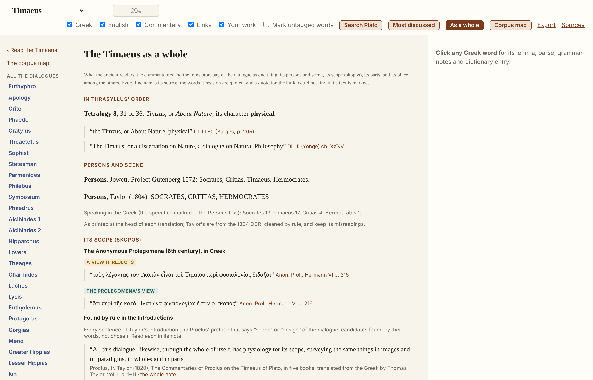

- **As a whole** (top right, or `#timaeus/whole`): for the dialogue you are reading, or any of the 36. Each line
  names its source and quotes the words it rests on; click a citation of an ancient text to read the passage (and
  the OCR as received). Reading orders and myths link to the corpus map.
  - *Persons and scene*: as printed at the head of Jowett's translation and of Taylor's (1804 OCR, cleaned by rule,
    misreadings kept), with who speaks in the Greek as the Perseus text marks it.
  - *Its scope*: the Prolegomena's statements, chosen by hand, in Greek, marked as its own view or as one it
    rejects; and every sentence of Taylor's Introduction (and Proclus' preface, for the Timaeus) that says "scope"
    or "design" of the dialogue, found by rule (`SCOPE` in `tools/structure.py`) and so offered as candidates.
  - *Divisions*: Archer-Hind's chapters of the Timaeus, spans read from his headings (every reading of the OCR
    noted; a summary the OCR breaks at a page ends […]); Jowett's sidenotes, placed at the section (Republic) or
    page (vol. II) printed before them.
- **Where you are in the whole**: beside the text, the chapter, Jowett's sidenotes and the myth or image the page
  is in.
- **Corpus map** (`#corpus`): the 36 works in Thrasyllus' nine tetralogies. Draw over them an ancient order
  (Thrasyllus, Aristophanes' trilogies, where readers began, Albinus' order and classes, Iamblichus' curriculum of
  twelve), a dramatic sequence, a myth or image (or a group, such as the three judgment myths), the citation web
  between dialogues, or the dialogues a speaker speaks in. Below the map, every item with its quotation.

  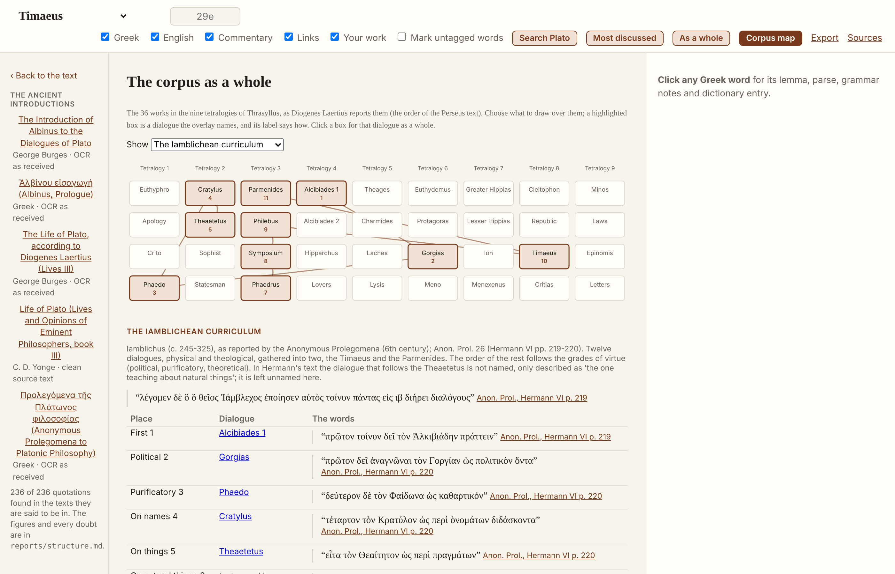
- **Where it comes from.** `sources/structure/` holds the claims written for this milestone: reading orders
  (`orders.json`), dramatic sequences (`sequences.json`, each step quoting Burnet's Greek where the dialogue says
  it), myths and images (`themes.json`: where a passage begins is a quotation of the Greek; where it ends is chosen
  by hand and marked so), and the Prolegomena on the skopos (`skopos.json`). `tools/ancient.py` reads the ancient
  texts into `texts/ancient/` (sections, chapters or pages as printed; a section number the OCR garbled is read as
  the next due, and says so); `tools/structure.py read` reads the printed divisions and the persons into
  `texts/structure/`; the build checks every quotation and writes [`reports/structure.md`](reports/structure.md).
  For each myth and image it also lists the notes placed in the passage that name it, and the notes of the
  citation web that link two passages of it.

| | |
|---|---:|
| Quotations checked, found | 236, 236 |
| Reading orders and classes, items | 6, 103 |
| Dramatic sequences, steps | 4, 13 |
| Myths and images, passages | 22, 25 |
| Archer-Hind's chapters | 44 |
| Jowett's sidenotes | 1,679 |
| Statements of the skopos: chosen, found by rule | 20, 27 |

## Word search and word studies

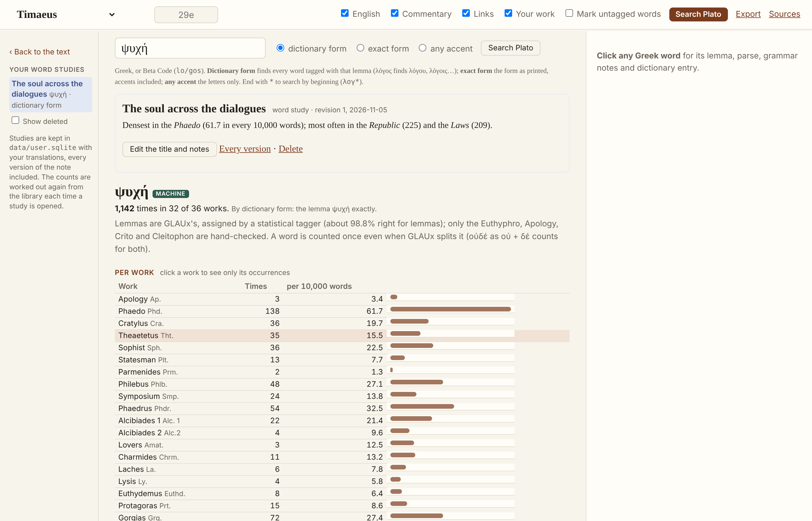

*Search Plato* at the top (or the <kbd>/</kbd> key) finds a word in all 36 works.

- **By dictionary form** (the lemma): every word GLAUx tagged with that lemma, so λόγος finds λόγου,
  λόγοις, λόγων. Marked *machine*, since the lemmas are the tagger's. A word GLAUx splits in two
  (οὐδέ as οὐ + δέ) counts once for each part.
- **By exact form**: the form as printed, accents included. **By any accent**: the letters only.
- Type Greek, or Beta Code (`lo/gos`). End with `*` to search by beginning (`λογ*`): every lemma or
  form found is listed with its count, and any can be left out. If no lemma has exactly the spelling
  typed, the lemmas with the same letters are searched instead, and the page says so.
- **Counts per dialogue**, as numbers and per 10,000 words of the dialogue, so the long works do not
  hide where a word is densest. Click a dialogue to see only its occurrences.
- **Every occurrence** in reading order, with the words around it, its lemma and parse, and its
  reference. Click the word for the full word box; click the reference to read it in place, with the
  word selected.
- **Elsewhere in Plato.** The word box shows how often the word's lemma occurs in all of Plato and
  in which dialogues most, and links to every occurrence of the lemma or of the exact form.
- **Word studies.** *Save as a word study* keeps the search (word, kind of search, any dialogues
  or forms chosen) with a title and your notes in Markdown. Studies are listed in the left column of
  the search page. Like your translations, every version of the title and notes is kept, an edit
  from a second tab is refused rather than lost, delete can be undone, and studies are in the
  Markdown and JSON exports. The counts are worked out again each time a study is opened.

The counts come from two tables the build fills (`lemma_count`, `form_count`), so a search of
all of Plato answers at once; the code is [`tools/search.py`](tools/search.py).

## The word box

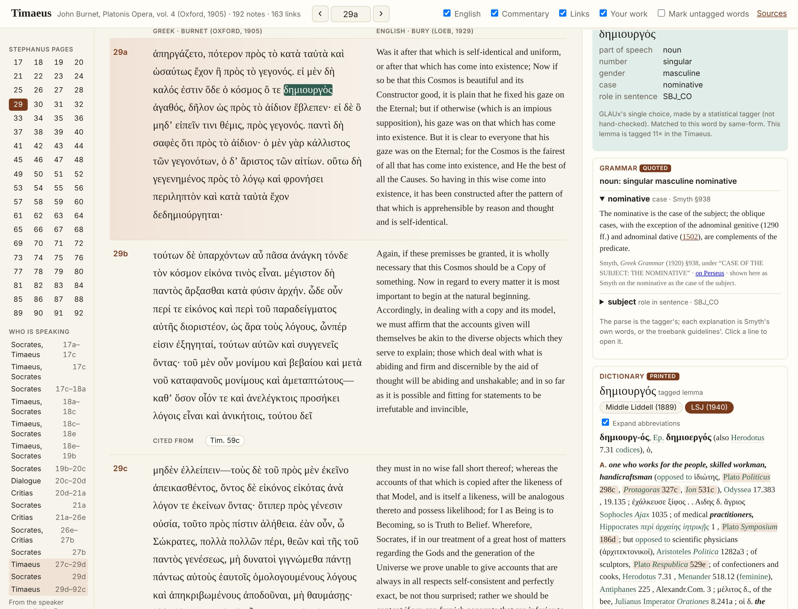

Click any Greek word. From the top:

- **Tagged** (green, *machine*): GLAUx's lemma and parse, as in milestone 2.
- **Grammar** (*quoted*): the parse said in a line (*verb: 3rd person singular aorist
  indicative passive*), then one line per category Smyth has something to say about. Open a
  line for the rule as Smyth states it (§1923: *The aorist expresses the mere occurrence of an
  action in the past…*), the whole section on request, and a link to it on Perseus. The sentence
  role (SBJ, ATR, AuxY…) opens to the definition in the treebank guidelines GLAUx follows.
  Which Smyth section goes with which category is listed, with the reason for each, in
  [`sources/grammar/smyth-sections.json`](sources/grammar/smyth-sections.json); change a
  line there and rebuild. The words of every note are Smyth's or the guidelines'.
- **Dictionary** (*printed*): Middle Liddell by default, LSJ one click away; the choice is
  remembered. If the chosen dictionary has no entry and the other has, the other is shown and
  the box says so. *Expand abbreviations* (on by default) swaps each abbreviation for LSJ's
  own expansion: *Pl.* → *Plato*, *Ti.* → *Timaeus*, *metaph.* → *metaphorically,
  metaphorical*, *c. gen.* → *cum genitive*. Hover any of them for the other form, and for an
  author LSJ's epithet and date. An abbreviation LSJ's list gives two meanings for (*Ep.*:
  Epic, or Epistula) is never swapped; hover shows both. LSJ's citations of the Timaeus are
  outlined and jump to the passage (1,486 of them in the entries loaded); a cross-reference
  (*v. ἔργον*) opens that entry. *Wide view* opens the entry in a large window.
- **Every possible parse**: as before, but each lemma with an entry is a link to it.

**How a lemma finds its entry.** The lemma and the dictionary key are compared in Beta Code
without homonym numbers or vowel-length marks. If nothing matches, the same letters and
breathing with a different accent are tried, then the bare letters; either is shown with a
warning to check it is the same word (Middle Liddell misprints εἷς as εἵς, for example).
Of the 2,534 lemmas tagged in the Timaeus, 2,470 have an LSJ entry and 2,263 a Middle Liddell
entry. The rest are mostly names and words the dictionaries file under another headword
(πρῶτος under πρότερος in Middle Liddell, ταύτῃ under οὗτος); the box says there is no entry
and links to Logeion. Nothing is guessed and no definition is written.

**How abbreviations are expanded.** LSJ's front matter is read from the Perseus TEI:
List I (1,025 authors, 683 works), Lists II to IV (298 inscription, papyrus and periodical
publications) and List V (506 general abbreviations). Inside a citation the author comes from
List I and the title from that author's works; in running text, the longest run of words
List V explains is marked. Eight single words are explained only inside a printed phrase
(List V has *c. gen. pers. = cum genitivo personae* but no *c.*); they are recorded as such in
the `abbreviation` table. Middle Liddell's own list of abbreviations is not digitised, so in its
entries only grammatical abbreviations and the authors LSJ abbreviates the same way (*Hdt.*,
*Ar.*) are expanded; *Plat.*, *Xen.* and the like are left as printed.

## Your translations and notes

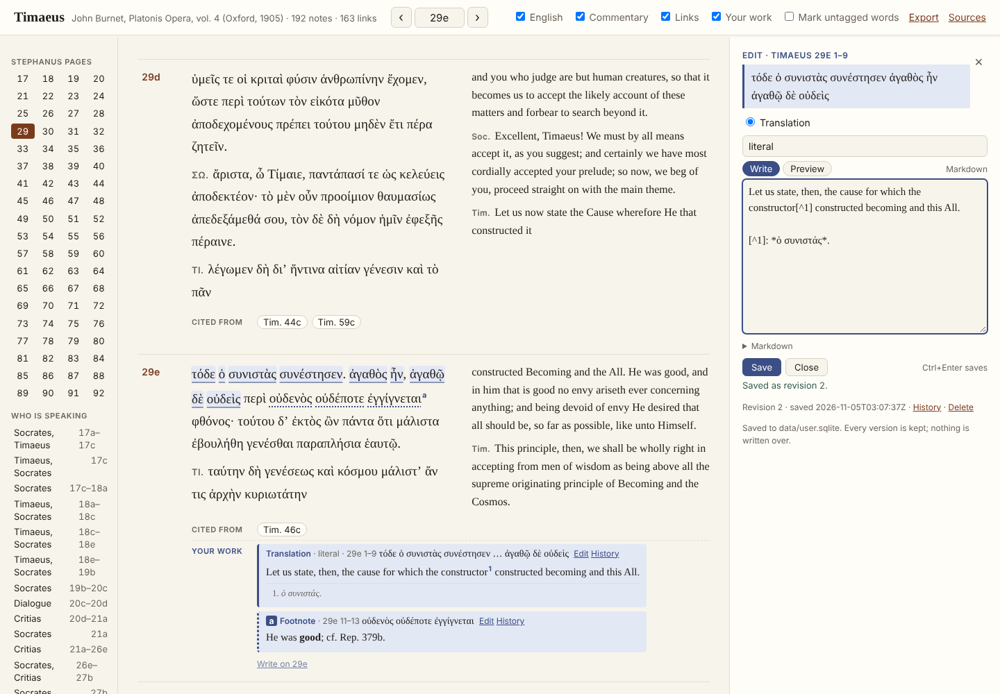

- **Choose the words.** Drag across Greek words (a partly selected word counts), or click
  one word and Shift-click the last; a bar offers *Translate*, *Footnote*, *Note* and
  *Alternative*. A span may run across sections. *Write on 29e* under a section takes the
  whole section, and the word box has the same four buttons for the word alone.
- **Write.** The editor opens in the right-hand column with the Greek you chose above it.
  Give the text a name if you like (*literal*, *after Taylor*): several translations of the
  same words are your alternative renderings, told apart by name. Text is Markdown:
  `*italic*`, `**bold**`, `> quotation`, lists, links, and footnotes inside a translation
  (`…the maker[^1] of…` with `[^1]: The note.` on its own line), numbered for you.
  *Preview* shows it as it will appear; Ctrl+Enter saves.
- **On the page.** Under each section, *Your work* lists what starts there, with its span
  (*29e 1–9*: section, then word numbers) and the opening and closing Greek words. Words
  under a translation are underlined; a footnote, note or alternative on words gets a
  letter (a, b, c) after its last word, so it is not confused with Bury's numbered notes.
  Hover an item to light up its words. The *Your work* switch at the top hides all of it.
- **History.** Every save is a new revision; *History* shows them all, and *Bring this
  version back* saves an old one as the newest, leaving the rest in place.
- **Delete** hides an item from the page. It stays, with its history, and *Export* lists
  deleted items with a *Restore* button.
- **Export** (top right): Markdown in Stephanus order, with the Greek of every span and your
  footnotes; JSON with every version and the deleted items; or a copy of `user.sqlite`.
  From the command line: `python3 tools/mywork.py md my-plato.md` (or `json`, `sqlite`).

**How your text is kept safe.**

- It is in `data/user.sqlite`, a separate file from the library. `build_db.py` only ever
  creates its tables if they are missing.
- Nothing is overwritten. Each save adds a row to `revision`; delete only marks the item.
- Two tabs cannot clobber each other: a save names the revision it was edited from, and if
  the text has changed since, the server refuses, shows you the saved version, and keeps
  yours in the editor. *Save mine as the newest version* then saves it on top, and the other
  stays in the history.
- Unsaved typing is kept in the browser as a draft and brought back if the page is closed or
  reloaded; leaving with unsaved text asks first.
- An upgrade of the file's layout (milestone 4 is the first) copies it to `data/backups/`
  first, then only adds columns.
- Anchors keep the Greek words as well as their numbers. If a re-import ever changes the
  text under an anchor, the item says so and shows the words you wrote it on; it is never
  moved or rewritten automatically.
- The server writes only for the reader it serves: it listens on 127.0.0.1, checks the
  Host and Origin of every write, and accepts only JSON, so no other web page can post to it.

**Two choices, each one line to change** in [`tools/mywork.py`](tools/mywork.py):
`SPAN_UNITS = "words"` (any run of words; `"sections"` widens every selection to whole
Stephanus sections) and `DEFAULT_FORMAT = "markdown"` (or `"plain"`). Each item records the
format it was written in, so changing the default leaves earlier work displayed as written.

## The database

Two SQLite files in `data/` (not committed):

| File | What | Written by |
|---|---|---|
| `workshop.sqlite` | The library: everything imported from the sources | `tools/build_db.py`, rebuilt from scratch every time |
| `user.sqlite` | Your translations, notes, word studies and every revision of them | You, through the reader (`tools/mywork.py`). A rebuild only creates missing tables |

Your rows point into the library by CTS URN, Stephanus reference and word number within
the section (`urn:cts:greekLit:tlg0059.tlg031`, `29e`, words 1 to 9) and keep the Greek
words themselves, never internal row numbers, so a rebuild cannot orphan them.

The library holds the five layers of the plan, each anchored to a work and a
Stephanus section, and every row names its source:

| Layer | Tables | Timaeus, milestone 2 |
|---|---|---|
| Provenance | `source` | One row per manifest entry, with the commit actually on disk |
| Text | `edition`, `chunk`, `token` | Burnet's Greek and Bury's English, 364 sections each; 23,677 Greek words, each addressed by character position |
| Word evidence | `tag`, `morph` | GLAUx lemma and parse for 23,670 words (99.97%), all machine-tagged; every Morpheus parse for 99.9% of words |
| Structure | `division` | 76 Stephanus pages and 41 speeches. Parts of the argument and skopos: milestone 9 |
| Commentary | `commentary`, `note` | Bury's 192 Loeb notes, anchored to the section they are printed in; from milestone 7 the commentaries, each note with its place, the Greek words it is on, and how they were found |
| Links | `link` | 163 references read from those notes by pattern (101 within the Timaeus); from milestone 8 every note's references, each with its certainty and the reason for any doubt |
| Dictionaries | `lexicon`, `lex_entry`, `lemma_entry`, `abbreviation` | 4,000 LSJ and 3,209 Middle Liddell entries: every lemma GLAUx or Morpheus gives for a word of the text, and the entries those cross-refer to; LSJ's lists of abbreviations |
| Grammar | `grammar_note`, `relation_label` | 32 notes from 31 sections of Smyth; 22 sentence-role definitions |
| Search (milestone 5) | `lemma_count`, `form_count` | How often each lemma and each printed form occurs in each work |

Milestone 5 imports all 36 works the same way; the figures above are the Timaeus's, and
[`reports/corpus.md`](reports/corpus.md) has every work's.

The full schema, with a comment on every column, is [`db/schema.sql`](db/schema.sql)
and [`db/user_schema.sql`](db/user_schema.sql).

**How GLAUx's tags are matched to the words.** GLAUx tokenises the same Perseus text
slightly differently, so its words are lined up with ours section by section. A word is
tagged only when the match is certain: the same letters (`same-form`), or GLAUx writing it
as two words that spell it exactly, as with οὐδέ as οὐ + δέ (`split-word`, 124 words). The
7 words left untagged are the 6 Burnet brackets as spurious, which GLAUx leaves out, and
one οὐδέ at 17b where the two tokenisations do not line up.

**How links are read.** A `<title>` in a note naming a work of Plato, followed by Stephanus
numbers (`Rep. 369 E ff., 374 E ff.`), gives one link per number; a letter on its own carries
the page before it (`Laws 892 A, B`). A bare number and letter (`cf. 31 B`) is a reference
within the note's own dialogue when the page is one of its pages (17 to 92 for the Timaeus). Titles after another author's name (`Eurip. Ion`) are
skipped. References are recorded as printed, mistakes included: Bury's "Phaedo 244 A" at
71e is surely the Phaedrus, and his misprint "Ref. 416 D" at 18b is not read at all.

## What milestone 1 found

| Layer | Source | Result |
|---|---|---|
| Greek text | Burnet's Oxford text, Perseus TEI | All 36 works of the tetralogies. Timaeus: 364 Stephanus sections, 17a to 92c, no gaps. Across the corpus the only breaks in the Stephanus sequence are the book divisions of the Republic and Laws. |
| English | Perseus (Loeb translators: Fowler, Lamb, Bury, Shorey) | All 36 works, with the same Stephanus sections as the Greek. Their footnotes (184 on the Timaeus) are a first, already-anchored commentary layer. |
| English | Jowett (1892) | Timaeus in hand, with his 40,000-word Introduction and Analysis. |
| English | Taylor and Sydenham (1804) | All five volumes in hand as unproofread OCR. About 9% of words need the long s restored. |
| Lemmas and grammar | GLAUx | Every word of Plato with a lemma, a parse and a Stephanus section. 99.5% of the Timaeus lines up word for word with the Perseus text. |
| Every possible parse | Perseus Morpheus table | Covers 99.6% of the distinct word forms in the Timaeus; about half of them have more than one possible parse. |
| Dictionaries | LSJ; Middle Liddell | Headwords found for 97.5% (LSJ) and 89.3% (Middle Liddell) of the Timaeus lemmas. Most misses are proper names and adverbs that the dictionaries list under another word. |
| Abbreviations (milestone 3) | LSJ front matter, Perseus | Not in the GitHub copy of LSJ; downloaded from Perseus and pinned by SHA-256. |
| Grammar (milestone 3) | Smyth (1920), Perseus; AGDT 2.0 guidelines | Smyth downloaded from Perseus and pinned by SHA-256; the guidelines from Perseus's treebank repository. |

### About the lemma data

GLAUx's lemmas and parses were assigned by statistical taggers trained on
hand-checked treebanks (about 98.8% accurate for lemmas, 97.2% for parses).
Only Euthyphro, Apology, Crito and Clitophon are hand-checked; the Timaeus is
entirely machine-tagged. The Workshop will label this data as tagged, never
present it as established, and show Morpheus's rule-based list of every
possible parse beside it, so you can always see the alternatives. Daniel
approved using GLAUx on 5 November 2026.

### What this environment cannot reach

gutenberg.org, archive.org, wikisource.org, sacred-texts.com, hathitrust.org and
distantreader.org were blocked from the cloud environment used for milestone 1,
so sources there had to be uploaded. The environment used on 5 November 2026
for Taylor's volume I reaches theosophylib.com, gutenberg.org, archive.org,
wikisource.org and sacred-texts.com (hathitrust.org still answers 403). GitHub works,
which covers Perseus, GLAUx, the lexica, First1KGreek and the GITenberg mirror
of older Project Gutenberg books. (Network access was widened for milestone 3, which is how
the Perseus website's downloads became reachable.)

## The concept index

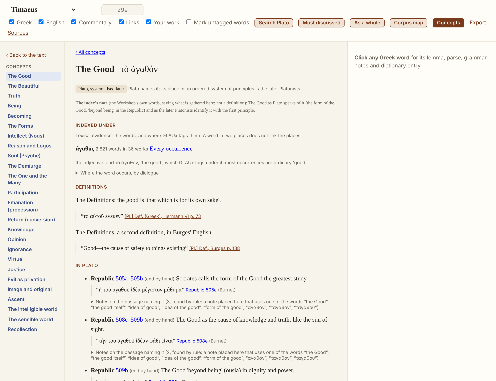

- **Concepts** (`#concepts`): all 197, with a filter by name, Greek or layer, each with its Greek name, its layer,
  where it was gathered from (the index, the *Definitions*, Taylor's terms, Alcinous, the scholia, the later
  Platonists), the words it is
  indexed under and the number of its definitions, passages, later readings and relations. `#concepts/the-good` opens one:
  - *The index's note*: one sentence on what is gathered there, marked as the Workshop's own words, not a definition.
  - *Indexed under*: the GLAUx lemmas (νοῦς is tagged νόος), with a count per dialogue and a link to every
    occurrence. This is lexical evidence: a word in two places does not link the places, and a word that is
    mostly the ordinary sense (εἰμί, λόγος) says so.
  - *LSJ cites*: under each word, the places of Plato LSJ cites for it, sense by sense, with LSJ's English and
    the Greek it quotes, marked ✓ where the quotation is word for word in Burnet at that place (LSJ often adapts
    its quotations, so about half are not); and the whole LSJ and Middle Liddell entries, opened on demand.
  - *Definitions* and *In the later Platonists*: each a quotation, with where it is (click to read the passage
    of an ancient text, or the whole note).
  - *In Plato* (or, for a later doctrine, *The passages it is read in*): each passage with Burnet's Greek where it
    begins (where it ends is chosen by hand), why it is here, the note that reads it so if it is a later reading,
    and the notes placed on it that name the concept (found by rule, by the keywords in `concepts.json`; read the
    note).
  - *Related concepts*: "the Good is the cause of Truth", each with its kind of relation and the words it rests
    on, and the relations other concepts state to this one. The kinds are listed with their counts under
    the index.
- **Words across the translators** (`#renderings/<lemma>`, linked from the index and from each concept): every
  place in a dialogue where the word stands, with Burnet's Greek (the word marked) and, beside it, the passage in
  each translation (Jowett, Fowler, Taylor...). The English is the passage, not an aligned word: no rendering
  is guessed.
- **Layers**: *Plato* (he names it and argues about it), *Plato, systematised later* (the Good, Intellect, the
  Demiurge, the One and the Many: his words, the later Platonists' order of principles), and *Later Platonist*
  (Emanation, Return, Evil as privation: Plato does not name them), and *Plato's school* (a term defined in the
  *Definitions* that the index has not otherwise gathered).
- **In the reader**: "Where you are in the whole" names the concept passages on the page; the word box names the
  concepts indexed under the word's lemma (the word, not that place).
- **Where it comes from.** `sources/concepts/sources.json` maps, by hand, each term the *Definitions* (176) and
  Taylor's terms (65) define to a concept, quotes Alcinous chapter by chapter (51) and the scholia (25), states
  17 relations with the words they rest on, and quotes the later Platonists' books (Taylor's Plotinus, 1817;
  Proclus' *Theology of Plato*, 1816; Iamblichus, 1821; in `sources/taylor-*`); the words of each definition are
  cut from the text by rule. `sources/concepts/concepts.json` is written by hand; its quotations are of Burnet's
  Greek (`plato`), of the ancient texts in `texts/ancient/` (`alcinous-burges`, `definitions-hermann`,
  `definitions-burges`), of Taylor's Platonic terms (`taylor-terms`), or of a note in the library (`note`: by
  commentator, dialogue and section). `tools/concepts.py` checks every one, fills the concept tables, and writes
  [`reports/concepts.md`](reports/concepts.md). `tools/scholia.py` reads Hermann's *Scholia Platonica* (vol. VI) into
  `texts/commentary/<dialogue>/scholia-hermann.json`; the commentary build places each scholion at its printed
  Stephanus page and letter (≈ where the page number had to be inferred, and the reading kept).

| | |
|---|---:|
| Concepts | 223 |
| Quotations checked, found | 722, 722 |
| Terms (GLAUx lemmas) | 243 |
| Passages of Plato | 87 |
| Later readings (Alcinous, scholia, Plotinus, Proclus, Iamblichus, notes) | 123 |
| Relations between concepts, kinds | 80, 17 |
| Words compared across the translators | 39 |
| LSJ's citations of Plato under those words; quoted, word for word | 1,509; 602, 280 |
| Notes naming a concept on its passages | 91 |
| Greek scholia imported | 1,515 |

## The commentaries across Plato

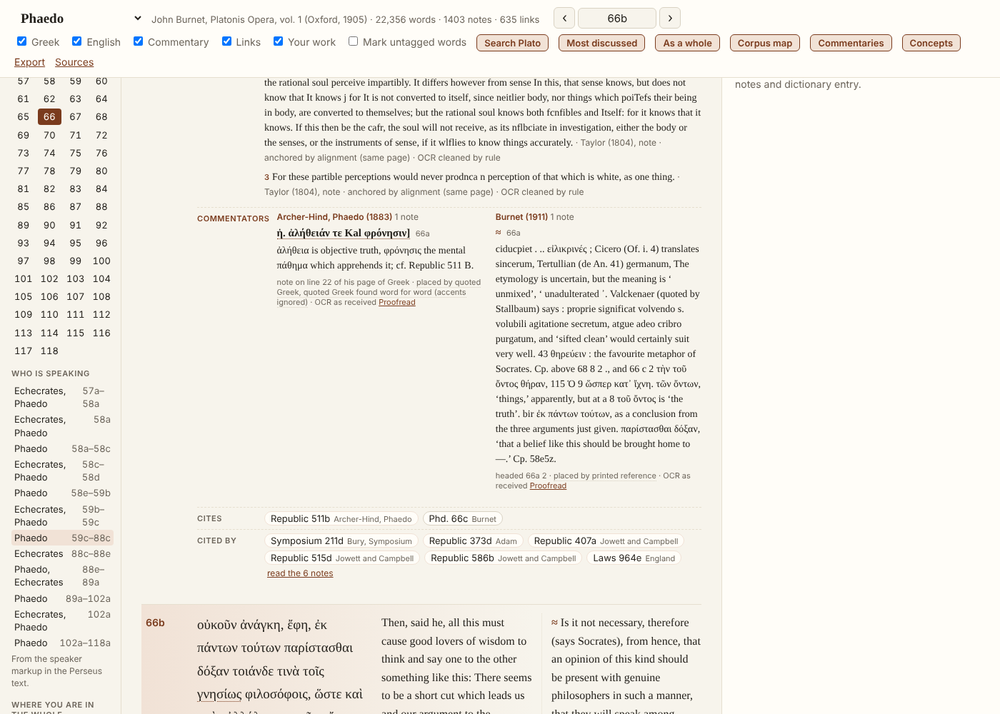

| Commentary | Dialogue | Notes | How they are placed |
|---|---|---:|---|
| Adam (1902), 2 vols. | Republic | 1,776 | Headed by page, letter and line (`568 D 26 θρέψεται`), or the line alone on the same section. Vol. I's OCR reads the Greek in Latin letters, so its notes rest on the reference only. |
| Jowett and Campbell (1894), vol. III | Republic | 2,202 | The Greek quoted and a bracket; found in Burnet's text. |
| England (1921), 2 vols. | Laws | 3,904 | Headed by page, letter and line (`659a1.`), or letter and line on the page before. |
| Burnet (1911) | Phaedo | 614 | Letter and line, the page from the running head (`NOTES 59`). |
| Archer-Hind (1883) | Phaedo | 527 | The Greek quoted and a bracket, as in his Timaeus. |
| Campbell (1883) | Theaetetus | 797 | The Greek quoted and a bracket. |
| Campbell (1867) | Sophist, Statesman | 709, 670 | The Greek quoted and a bracket. |
| Bury (1909) | Symposium | 217 | Page and letter (`176 C ἐξαιρῶ λόγον`). |
| Lodge (1896) | Gorgias | 784 | Line and the Greek quoted, then a colon. |
| Jowett, Introductions (1892; Republic 1888) | 27 dialogues | 1,981 paragraphs | On the whole dialogue: *Introductions* in the Commentary bar. |

- **Placed by the printed reference.** A note headed by its Stephanus reference is at that section. Where it quotes
  Greek, the words are looked for there in Burnet's text: found word for word, the note is on those words (dotted in
  the text), and the reference is confirmed by the text itself. A letter printed without its page takes the page
  of the note before, or the next page where the letter is lower than the one before; such a counted page is
  checked by the Greek in the same way, the note moved to where the Greek is only if the words are found at one place
  alone within two pages, and marked ≈ if the Greek cannot confirm it.
- **Placed by the Greek words.** A note headed by the Greek alone is placed as Archer-Hind's Timaeus notes were in
  milestone 7. Printed in the order of the text, 98 to 99.7% of them are placed in order, which is the check.
- **Every note says how** (hover *placed by…*), keeps the OCR as received, and can be proofread and corrected in your
  own database as in milestone 7.
- **All the commentaries**: *Commentaries* lists the 102 commentaries and introductions in the library, dialogue by
  dialogue, with their notes, the sections they cover, how many are on the Greek words and how many are ≈; each can
  be read straight through, its notes linked to their passages.
- **Looked for and left out**, with the reason (Thompson's Gorgias and Phaedrus, whose only scans read the Greek in
  Latin letters; Bury's Philebus; Adam's Euthyphro and Crito; others), and six more found with legible Greek, to read
  next, are listed at the end of [`reports/commentaries.md`](reports/commentaries.md).
- **Rebuilding.** `python3 tools/commentary_corpus.py fetch` downloads the OCR again (the copies in `sources/` are
  committed, with `fetched.json`); `python3 tools/commentary_corpus.py` reads them into `texts/commentary/<dialogue>/`
  (committed); `tools/build_db.py` places the notes and writes the report.

## Reconciliations

`#reconcile` lists the tensions; each has a page (`#reconcile/soul-simple-or-in-parts`) in this order: the
question; the nature of the contradiction; who sees the tension, quoted; the passages, each with Burnet's Greek,
an English translation at the same section, a plain summary, the words at issue (with GLAUx's count of them in
the passage, the senses Middle Liddell and LSJ give, and *cites 78d* where LSJ cites the passage itself) and the
commentators' notes printed on it; the notes on one passage that cite another (from the citation web); the
concepts; the readings, each with its method, who holds it and the words it rests on; and the methods the
database retrieves for the tension, each with why. Text marked † is the Workshop's own summary, not a quotation.
Under a section of the reader that begins one of these passages, *Tension* links to its record.

- **The records** are `sources/reconcile/tensions.json`, the **methods** `sources/reconcile/methods.json`:
  edit either and run `python3 tools/reconcile.py` (seconds) to rebuild just these tables, with every quotation
  checked again. A quotation is looked for in Burnet's Greek at the section named (accents normalised), in the
  translator's English at that section, in the note of the commentator named at that place, in Taylor's books
  (Plotinus, Proclus' *Theology*, Porphyry, Taurus, from Project Gutenberg: `tools/fetch_reconcile.py`), or on the
  web page named. The web pages are fetched by `python3 tools/reconcile.py --web`, which records in
  `sources/reconcile/web-checks.json` whether each quotation, and the author named in its citation, is on the page.
- **Established and proposed.** A reading is established only when its holder is quoted giving it; the build
  refuses an established reading with no quotation. Every proposed reading is by "the Workshop". Every tension
  has at least two readings, and none is shown as the answer.
- **Methods retrieved for a passage.** `/api/applicable/<work>/<ref>` gives the tensions the section is in, the
  concepts whose passages contain it, and the methods those retrieve, each with the reason.
- **Worksheets** (`#reconcile/new?tension=…`, or *New worksheet* for passages of your choice) have nine steps:
  the passages, the contradiction, dictionary evidence, commentary, methods, your interpretation, your reconciled
  translation, references and status (in progress, or your proposal). Each step shows the record's evidence beside
  it. They are kept in `data/user.sqlite` (schema version 5, upgraded in place after a backup) like your other
  work: every version kept, a second tab refused rather than written over, delete and restore, and exported with
  everything else to Markdown and JSON. *Compare* (`#reconcile/compare/<id>`) sets the recorded readings and your
  worksheets side by side.
- **Your own methods** (on the methods page) need a citation and may be placed with concepts, which retrieves
  them for the tensions on those concepts.

## Search everything

The box at the top (`f` to reach it) searches the whole Workshop; `#find?q=…` is the address of a search. It
looks in Burnet's Greek, every English translation, every note, the ancient texts, the concept index, the
reconciliations and methods, the dossiers when there are any, the names of works, commentators, translators and
ancient authors, and your own work. A Stephanus reference (`Rep. 509b`, `Tim 29e-30a`) gives the passage, the
notes on it, the notes anywhere that cite it and the concepts and tensions it belongs to. A single Greek word is
searched by lemma as well as in the text. Fields narrow a search: `lemma:` `form:` `plain:`, with `case:`
`number:` `tense:` `mood:` `voice:` `person:` `gender:` `pos:` `degree:` for a morphological filter
(`lemma:λόγος case:gen in:Tim`); `greek:` `english:` `note:` `ancient:` for one text; `in:` (or `work:`) for one
dialogue; `by:` for a commentator or translator, `translator:` for a translator; `cites:Rep 509b`; `concept:`
`tension:` `method:`; and `mine:` for your work alone. Words in double quotes are an exact phrase.

Every result carries a line saying why it was returned: "Jowett's English of Republic 509b contains the
words", "tagged by GLAUx with the lemma λόγος, parsed case genitive (machine tagging, not checked by hand)",
"the note cites “509 B”, read as Republic 509b (certain, rule page in this dialogue)". Nothing is ranked by
meaning: the texts are matched word for word by SQLite's full-text index (accents and capitals ignored, built
with the library by `tools/find.py`), the rest by the words appearing in the named fields. From the command line:
`python3 tools/find.py lemma:ψυχή case:dat`.
## Passage dossiers

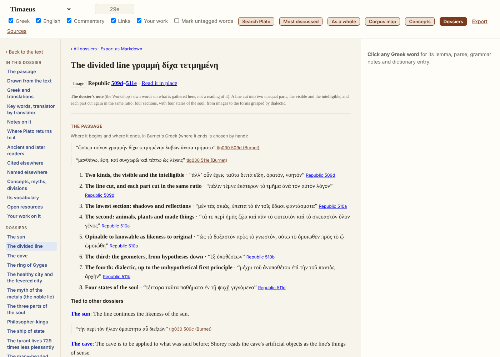

A dossier is one famous passage gathered whole. The hand-written part is small and checked: where the passage
begins and ends, its stages, the places Plato returns to it, the dossiers it is tied to, the ancient readers
who quote it, the key words whose renderings are compared, and the web pages that discuss it. Every one of
these quotes the words it rests on, and the build looks for each in the text it names (Burnet's Greek at the
section, the ancient texts, the notes, the translation at the section or the next). Everything else is
gathered by rule from the library:

- **Greek and translations**: every edition of the span side by side (Burnet, Jowett, the Loeb, Taylor or
  Sydenham), choose which with the boxes.
- **Drawn from the text**: a diagram whose every label is Plato's word at a section; point at a label for the
  Greek, click to read it in place. The divided line has a slider for the ratio of its cut; however it is cut,
  the two middle sections come out the same length.
- **Key words, translator by translator**: how each translator renders the passage's key words.
- **Notes on it**: every commentary note placed on the span (Proclus, Taylor, Archer-Hind and the rest).
- **Where Plato returns to it**: echoes elsewhere in the dialogues, each with the Greek and why.
- **Ancient and later readers**: Alcinous, Albinus, Diogenes Laertius and the others, where they quote it.
- **Cited elsewhere** and **Named elsewhere**: notes anywhere in the library that cite a section of the span, or
  name the passage by one of its words ("divided line", "Er", "Diotima"). The words are phrases chosen so that
  a note naming them is about the passage; common words were taken out.
- **Concepts, myths, divisions**: the concepts of the concept index and the myths and images of the whole that
  fall on the span, the chapters (Archer-Hind) or sidenotes (Jowett), and the speakers.
- **Its vocabulary**: GLAUx lemmas found only in this passage in all Plato, and those twenty times or more as
  frequent here; and shared phrases, runs of three lemmas (two of them rare) found here and in at most four
  other places.
- **Open resources**: the Stanford and Internet Encyclopedias of Philosophy, Wikipedia and Perseus, each with
  the words quoted from the page and the date it was last checked. Perseus pages are linked only where they hold
  the passage's Greek (38 do not, the Phaedrus among them, and are not offered).
- **Your work on it**: your translations and notes on the span.
- **Export as Markdown**: the whole dossier as a study sheet, every quotation with where it is from.

Each dialogue's table of contents lists the dossiers in it. The dossiers are in `sources/dossiers/`, one file per
dialogue, listed in `index.json` with the groups and kinds. To add one, write it there, then run
`python3 tools/webcheck.py` (fetches each web page it links to and records whether the quoted words are there,
in `sources/dossiers/web-checks.json`, so the build itself needs no network) and `python3 tools/build_db.py`;
[`reports/dossiers.md`](reports/dossiers.md) lists anything not found.

| | |
|---|---:|
| Dossiers | 71 |
| Works | 20 |
| Quotations found / checked | 809 / 809 |
| Diagrams | 17 |
| Renderings compared, found | 54 / 54 |
| Web pages, words found | 110 / 110 |
| Notes naming a dossier (on it / elsewhere) | 314 / 1,688 |
| Words found only in a dossier's passage | 762 |
| Shared phrases | 302 |

## Key terms in the text

- **The term list** is every concept of the concept index (228 terms in all: the index written by hand, the
  *Definitions*, Taylor's Platonic terms, Alcinous, the scholia) with what [`sources/terms/terms.json`](sources/terms/terms.json)
  adds: the Neoplatonic vocabulary the index lacked (the One, the henads, bound and the infinite, life, nature), Taylor's
  English forms of each term and the other translators', fixed English phrases, a one-line plain meaning, and passages and
  readings for the new terms. Every English form and phrase carries a quotation showing it used (Taylor's glossary, his
  General Introduction, a translation at a Stephanus section), and the build looks for each: 198 of 198 found.
- **In the Greek** a word is underlined when GLAUx's dictionary form for it is a term's (ἀγαθοῦ is the Good). For a very
  common word, only where Plato uses it as a name, neuter with the article: τὸ ἕν (the One), τὸ ὄν and τὰ ὄντα (being), but
  not τῷ ὄντι, which LSJ gives as "in reality". `tools/terms.py` says which rule each word has, and the Term tab repeats it.
- **In the English** a word is underlined only where the Greek of the same section has the term (so "good" only above
  ἀγαθός), or where a fixed phrase is printed as given, capitals and all ("the Good", "idea of good", "the beautiful itself").
  For Taylor's and Jowett's translations, whose sections are computed (≈), the Greek of every section the paragraph spans counts.
- **Which terms are underlined**: 105 of the 228, those gathered from anything but the *Definitions* alone, and those of
  terms.json. A term only the *Definitions* define (day, bone, festival), and six topics of Alcinous' physics and of the
  senses (hearing, sight, voice, respiration, disease, the heavy and the light), are in the list and open from the word box,
  but are not underlined. 28,077 words of Plato are marked.
- **The Term tab**: Taylor's explanation where he gives one; the plain meaning (or, without one, the first definition the
  sources give); the definitions; every place, by dialogue in the order chosen in the Library (the Neoplatonic curriculum
  by default), the current dialogue open, the sections on this page in bold, and ‹ › from where you are; which words are
  marked and the quotations behind the English forms; the key passages with their Greek and an *English* button; what the
  Platonists say; related terms, and terms that share a Greek word. *The whole entry in the concept index* and *Taylor's
  whole glossary* open in the panel.
- **The other tabs** follow the section you last tapped (or the first in view), with ‹ › between sections: *Notes* (the
  translators' notes and the commentators), *Links* (Cites and Cited by), *Your work* (and the editor, when you write).
  Everything also stays under each section in the text, as before.
- `/api/term/<id>`, `/api/terms`, and the page's `term_tokens`, `chunk_terms`, `terms` and `phrases` (tools/serve.py).
  Tables `term`, `term_lemma`, `term_form`, `term_hit` (db/schema.sql). Tests in `tests/test_terms.py`, with
  `tests/terms_browser.js` in a real browser at the laptop's size and two iPad sizes.

## Layout

```
sources/          what we use and where it comes from (committed)
  manifest.json
  COMMENTARIES.md
  TIMAEUS_PILOT.md
  taylor-1804/    OCR text, kept exactly as received
  taylor-1804-vol1-theosophylib/  corrected HTML of vol. I, kept as received, with provenance
  taylor-1804/dialogues.json  where each dialogue lies in the OCR of vols. II-V, and its translator
  jowett-gutenberg/  Jowett's translations from Project Gutenberg, as received, and which is which
  proclus-1820/, archer-hind-1888/  Internet Archive OCR of the commentaries, as received, with provenance
  burges-1854/, yonge-1853/, hermann-appendix/  Diogenes Laertius III, Albinus, the Anonymous Prolegomena, as received
  adam-1902/, england-1921/, burnet-1911/, bury-1909/, archer-hind-1883/, campbell-1883/, campbell-1867/,
  jowett-campbell-1894/, lodge-1896/  Internet Archive OCR of the commentaries of milestone 11, as received
  structure/      the claims of milestone 9: reading orders, sequences, myths and images, the skopos;
                  people.json: which speaker names are one person, for the voices of milestone 14;
                  workshop-words.json: the Workshop's own words in plain English and the help behind every ? (milestone 16)
  concepts/       the concept index of milestone 10 (concepts.json, sources.json)
  terms/          the key terms of milestone 17 (terms.json): the Neoplatonic vocabulary, Taylor's English forms, plain meanings
  reconcile/      the reconciliations of milestone 12: tensions.json, methods.json, sources.json, web-checks.json
  taylor-gutenberg/  Taylor's Proclus' Theology, Porphyry and Taurus from Project Gutenberg, as received
  dossiers/       the passage dossiers, one file per dialogue (index.json lists them), and web-checks.json
  translations/   milestone 15: the Workshop's English of the Prolegomena, the printed English paired with
                  Hermann's Greek, and coverage.json (how each kind of Greek in the reader gets its English)
  taylor-plotinus-1817/, taylor-proclus-theology-1816/, taylor-iamblichus-1821/  Taylor's later Platonists, as received
texts/            imported texts, one JSON file per work (committed)
  taylor-1804/vol1/
  taylor-1804/vol2/ ... vol5/  Taylor's OCR cleaned by rule, with the OCR kept beside it
  commentary/timaeus/  each commentary read into notes, with the OCR kept beside each
  commentary/<dialogue>/  Taylor's Introductions to 24 more dialogues (tools/taylor_intros.py), the scholia, and
                  the commentaries and Jowett's Introductions of milestone 11 (tools/commentary_corpus.py)
  ancient/        the ancient introductions, by section, chapter or page (tools/ancient.py)
  structure/      Archer-Hind's chapters, Jowett's sidenotes, the persons and scene (tools/structure.py read)
db/               schema of the library and of your own database
  grammar/        which Smyth section is quoted for which grammatical category
tools/            fetch, verify, import, build the database, serve the reader, Greek helpers,
                  lexicon.py (dictionary entries, LSJ's abbreviations), grammar.py (Smyth, treebank labels),
                  mywork.py (your translations, notes and word studies: the only code that writes user.sqlite),
                  search.py (the word search across Plato), jowett.py, taylor_ocr.py, align.py and
                  translations.py (the historical translations), commentary.py and commentary_db.py
                  (reading and placing the commentaries), citations.py (the citation web),
                  fetch_ancient.py, ancient.py, taylor_intros.py and structure.py (the whole, milestone 9),
                  scholia.py and concepts.py (the concept index, milestone 10),
                  commentary_corpus.py (the commentaries across Plato, milestone 11),
                  reconcile.py and fetch_reconcile.py (the reconciliations, milestone 12), find.py (the search box),
                  gloss.py and greek_audit.py (the meaning of any Greek word, and the audit of milestone 15),
                  webcheck.py --words (the web pages the Workshop's own words quote, milestone 16),
                  terms.py (the key terms underlined in the reader, milestone 17)
workshop.py       one command: download, build if needed, serve
reader/           the reader (HTML, CSS, JavaScript; no libraries); mywork.js is the editor, search.js the search,
                  commentary.js the commentaries, citations.js the citation web, whole.js the whole and the corpus map,
                  concepts.js the concept index, commentaries.js the list of every commentary,
                  reconcile.js the reconciliations and worksheets, shell.js the navigation, the search box, themes and panels,
                  help.js the ? help, Words used in the Workshop and the Contents button (milestone 16)
                  terms.js the key terms and the side panel's tabs (milestone 17)
                  dossiers.py and webcheck.py (the passage dossiers and their web checks)
reader/           the reader (HTML, CSS, JavaScript; no libraries); mywork.js is the editor, search.js the search,
                  commentary.js the commentaries, citations.js the citation web, whole.js the whole and the corpus map,
                  concepts.js the concept index, commentaries.js the list of every commentary, dossiers.js the passage dossiers
tests/
docs/             screenshots
reports/          output of verify_sources.py and of the build (corpus.md), committed so results are reviewable
data/raw/         downloaded sources (git-ignored)
data/*.sqlite     the library and your work (git-ignored)
data/backups/     copies of user.sqlite made before an upgrade (git-ignored)
```
